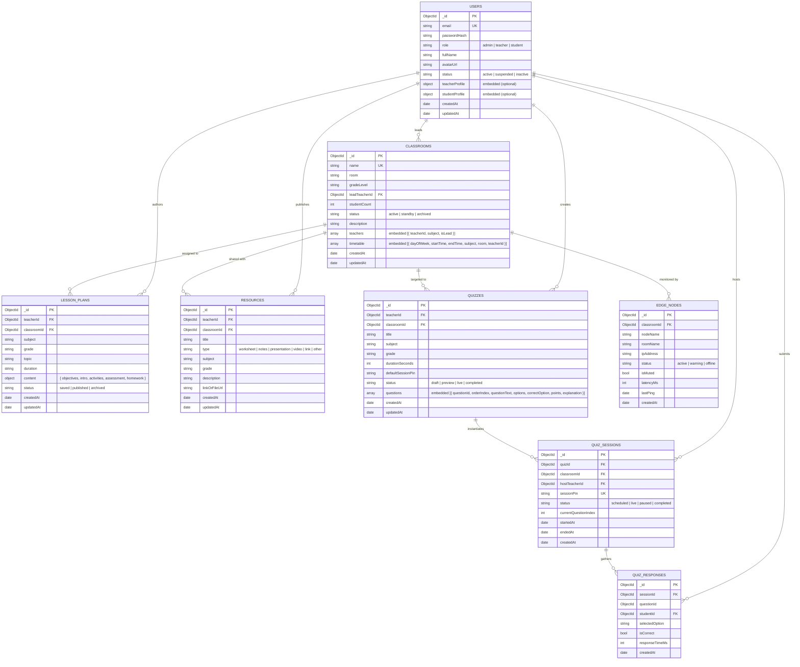

# ClassPulse Unified Database Schema & CRUD Integration Specification (MongoDB)

> **Scope**: Unified backend architecture and MongoDB document database schema consolidating **Admin (`SIH-admin`)**, **Teacher (`SIH-teacher`)**, and **Student (`SIH-student`)** dashboards into a shared, high-performance data plane.

---

## 1. Architectural Overview & Document Domain Mapping

ClassPulse transitions from rigid relational tables to a modern, document-oriented data model optimized for MongoDB. The document model leverages **embedding** for tightly coupled, bounded entities (eliminating costly relational joins) and **referencing** for high-volume, shared, or write-heavy transactional data.

### Dashboard Responsibilities & Data Plane Mapping

| Dashboard | Primary Responsibilities | Collections & Documents Touched |
|---|---|---|
| **Admin (`SIH-admin`)** | Institutional governance, user lifecycle (RBAC), classroom provisioning, timetable management, IoT hardware fleet monitoring | `users` (CRUD), `classrooms` (CRUD + embedded timetable), `edge_nodes` (Fleet monitoring) |
| **Teacher (`SIH-teacher`)** | Pedagogical planning, content authoring, quiz creation, live classroom quiz broadcasting, student performance tracking | `lesson_plans` (CRUD), `resources` (CRUD), `quizzes` (CRUD + embedded questions), `quiz_sessions` (host/control), `classrooms` (read) |
| **Student (`SIH-student`)** | Timetable viewing, course resource access, live quiz participation via PIN, historical score tracking | `users` (self-read/profile), `classrooms` (read schedule), `resources` (read), `quiz_sessions` (join via PIN), `quiz_responses` (write responses) |

---

### Embedding vs. Referencing Decision Matrix

| Relationship | Pattern | Strategy | Architectural Justification |
|---|---|---|---|
| **User ↔ Profile** (Teacher / Student) | 1 : 1 | **Embedded Subdocument** | A user profile is accessed with the user identity 95% of the time. Embedding polymorphic subdocuments (`teacherProfile` or `studentProfile`) avoids a 1:1 join while indexing roll numbers and staff IDs directly. |
| **Classroom ↔ Teachers** | 1 : Bounded Few | **Embedded Array of Subdocuments** | A classroom typically has 5–10 assigned subject teachers. Storing `[{ teacherId, subject, isLead }]` directly inside the `classrooms` document eliminates junction tables (`teacher_classrooms`). |
| **Classroom ↔ Timetable Slots** | 1 : Bounded (~30–45) | **Embedded Array of Subdocuments** | A weekly school schedule has a fixed, bounded number of periods (e.g., 6 periods × 5 days = 30 slots). Embedding allows fetching a classroom's complete weekly timetable in a single O(1) document read. |
| **Quiz ↔ Questions** | 1 : Bounded (5–50) | **Embedded Array of Subdocuments** | Quizzes contain a bounded set of questions and choices. Storing questions inside the quiz document enables atomic updates, avoids multi-document transactions, and allows instant single-query quiz delivery. |
| **Quiz Session ↔ Quiz Responses** | 1 : Unbounded High Velocity | **Referenced Collection (`quiz_responses`)** | 40–100 students submitting 20 questions generate 800–2,000 writes in a 10-minute window. Embedding responses inside `quiz_sessions` would cause document fragmentation, lock contention, and risk exceeding the 16MB BSON limit. |
| **Classroom ↔ Edge Node** | 1 : 1 or 1 : Few | **Referenced Collection (`edge_nodes`)** | Edge nodes send high-frequency telemetry heartbeats (ping, latency, status) every 15–60 seconds. Keeping them in a separate collection prevents heartbeat writes from invalidating cached classroom documents. |
| **Classroom ↔ Students** | 1 : Unbounded (30–60+) | **Referenced via `studentProfile.classroomId`** | Student enrollment references the classroom ID. `classrooms` maintains a denormalized `studentCount` counter for fast UI rendering. |

---

## 2. Document Relationship Model



---

## 3. MongoDB Collection Design & BSON Specifications

### 3.1 Collection: `users`
Represents all system actors. Employs polymorphic embedded subdocuments based on `role`.

```json
{
  "_id": { "$oid": "660c1a2f4f1a25d3a8b4e001" },
  "email": "sarah.jenkins@classpulse.edu",
  "passwordHash": "$2b$12$eX4mP1eH4shV4lu3S3cur3P4ssw0rd...",
  "role": "teacher",
  "fullName": "Dr. Sarah Jenkins",
  "avatarUrl": "https://cdn.classpulse.edu/avatars/sarah-jenkins.webp",
  "status": "active",
  "teacherProfile": {
    "staffId": "TCH-501",
    "department": "Science & Biology",
    "bio": "Senior Biology faculty specializing in Cell Biology and Genetics."
  },
  "createdAt": { "$date": "2026-08-01T09:00:00Z" },
  "updatedAt": { "$date": "2026-08-15T14:30:00Z" }
}
```

*For Student Users*:
```json
{
  "_id": { "$oid": "660c1a2f4f1a25d3a8b4e002" },
  "email": "alex.chen@student.classpulse.edu",
  "passwordHash": "$2b$12$eX4mP1eH4shV4lu3S3cur3P4ssw0rd...",
  "role": "student",
  "fullName": "Alex Chen",
  "avatarUrl": "https://cdn.classpulse.edu/avatars/alex-chen.webp",
  "status": "active",
  "studentProfile": {
    "rollNo": "STU-1001",
    "classroomId": { "$oid": "660c1b7a4f1a25d3a8b4e010" },
    "nickname": "Al"
  },
  "createdAt": { "$date": "2026-08-10T10:00:00Z" },
  "updatedAt": { "$date": "2026-08-10T10:00:00Z" }
}
```

---

### 3.2 Collection: `classrooms`
Represents physical/virtual academic cohorts. Embeds assigned teachers and the weekly timetable schedule.

```json
{
  "_id": { "$oid": "660c1b7a4f1a25d3a8b4e010" },
  "name": "Grade 10-A",
  "room": "Science Lab 2",
  "gradeLevel": "Grade 10",
  "leadTeacherId": { "$oid": "660c1a2f4f1a25d3a8b4e001" },
  "studentCount": 32,
  "status": "active",
  "description": "Advanced STEM focused section with digital lab hardware integration.",
  "teachers": [
    {
      "teacherId": { "$oid": "660c1a2f4f1a25d3a8b4e001" },
      "subject": "Biology",
      "isLead": true
    },
    {
      "teacherId": { "$oid": "660c1a2f4f1a25d3a8b4e005" },
      "subject": "Mathematics",
      "isLead": false
    }
  ],
  "timetable": [
    {
      "_id": { "$oid": "660c1bf04f1a25d3a8b4e020" },
      "dayOfWeek": "Monday",
      "startTime": "09:00",
      "endTime": "09:45",
      "subject": "Biology",
      "room": "Science Lab 2",
      "teacherId": { "$oid": "660c1a2f4f1a25d3a8b4e001" }
    },
    {
      "_id": { "$oid": "660c1bf04f1a25d3a8b4e021" },
      "dayOfWeek": "Monday",
      "startTime": "09:50",
      "endTime": "10:35",
      "subject": "Mathematics",
      "room": "Room 301",
      "teacherId": { "$oid": "660c1a2f4f1a25d3a8b4e005" }
    }
  ],
  "createdAt": { "$date": "2026-08-01T08:30:00Z" },
  "updatedAt": { "$date": "2026-08-14T11:00:00Z" }
}
```

---

### 3.3 Collection: `quizzes`
Encapsulates quiz metadata and embeds its complete list of questions, choices, and scoring keys.

```json
{
  "_id": { "$oid": "660c20104f1a25d3a8b4e030" },
  "teacherId": { "$oid": "660c1a2f4f1a25d3a8b4e001" },
  "classroomId": { "$oid": "660c1b7a4f1a25d3a8b4e010" },
  "title": "Mitochondria & Cellular Respiration Sprint",
  "subject": "Biology",
  "grade": "Grade 10",
  "durationSeconds": 45,
  "defaultSessionPin": "739201",
  "status": "live",
  "questions": [
    {
      "_id": { "$oid": "660c20504f1a25d3a8b4e031" },
      "orderIndex": 1,
      "questionText": "What is the primary product of the Krebs Cycle used in oxidative phosphorylation?",
      "options": [
        { "key": "A", "text": "NADH and FADH2" },
        { "key": "B", "text": "Lactic acid" },
        { "key": "C", "text": "Glucose-6-phosphate" },
        { "key": "D", "text": "Ethanol" }
      ],
      "correctOption": "A",
      "explanation": "NADH and FADH2 donate high-energy electrons to the electron transport chain.",
      "points": 1
    },
    {
      "_id": { "$oid": "660c20504f1a25d3a8b4e032" },
      "orderIndex": 2,
      "questionText": "Where does glycolysis take place within the cell?",
      "options": [
        { "key": "A", "text": "Mitochondrial Matrix" },
        { "key": "B", "text": "Cytoplasm" },
        { "key": "C", "text": "Cristae Membrane" },
        { "key": "D", "text": "Nucleolus" }
      ],
      "correctOption": "B",
      "explanation": "Glycolysis is an anaerobic cytoplasmic pathway that does not require mitochondria.",
      "points": 1
    }
  ],
  "createdAt": { "$date": "2026-08-16T14:00:00Z" },
  "updatedAt": { "$date": "2026-08-16T14:20:00Z" }
}
```

---

### 3.4 Collection: `quiz_sessions`
Represents an active or historic live classroom quiz run.

```json
{
  "_id": { "$oid": "660c23a04f1a25d3a8b4e040" },
  "quizId": { "$oid": "660c20104f1a25d3a8b4e030" },
  "classroomId": { "$oid": "660c1b7a4f1a25d3a8b4e010" },
  "hostTeacherId": { "$oid": "660c1a2f4f1a25d3a8b4e001" },
  "sessionPin": "739201",
  "status": "live",
  "currentQuestionIndex": 1,
  "startedAt": { "$date": "2026-08-16T15:00:00Z" },
  "endedAt": null,
  "createdAt": { "$date": "2026-08-16T14:58:00Z" }
}
```

---

### 3.5 Collection: `quiz_responses`
High-frequency write collection. Records atomic student answers to individual questions.

```json
{
  "_id": { "$oid": "660c24d14f1a25d3a8b4e050" },
  "sessionId": { "$oid": "660c23a04f1a25d3a8b4e040" },
  "questionId": { "$oid": "660c20504f1a25d3a8b4e031" },
  "studentId": { "$oid": "660c1a2f4f1a25d3a8b4e002" },
  "selectedOption": "A",
  "isCorrect": true,
  "responseTimeMs": 4200,
  "createdAt": { "$date": "2026-08-16T15:01:14Z" }
}
```

---

### 3.6 Collection: `lesson_plans`
Stores detailed lesson plans authored by teachers.

```json
{
  "_id": { "$oid": "660c26004f1a25d3a8b4e060" },
  "teacherId": { "$oid": "660c1a2f4f1a25d3a8b4e001" },
  "classroomId": { "$oid": "660c1b7a4f1a25d3a8b4e010" },
  "subject": "Biology",
  "grade": "Grade 10",
  "topic": "Cellular Respiration & ATP Synthase",
  "duration": "45 minutes",
  "content": {
    "objectives": "Understand aerobic respiration stages and calculate net ATP production.",
    "introduction": "Recap glucose phosphorylation in 5 minutes with interactive slide deck.",
    "activities": "Divide class into 4 groups analyzing electron transport chain inhibitor models.",
    "assessment": "5-question live ClassPulse sprint quiz at the end of period.",
    "homework": "Complete Section 4.2 worksheet in ClassPulse portal."
  },
  "status": "published",
  "createdAt": { "$date": "2026-08-12T08:00:00Z" },
  "updatedAt": { "$date": "2026-08-12T08:00:00Z" }
}
```

---

### 3.7 Collection: `resources`
Curated course materials, worksheets, video lectures, and external references.

```json
{
  "_id": { "$oid": "660c27104f1a25d3a8b4e070" },
  "teacherId": { "$oid": "660c1a2f4f1a25d3a8b4e001" },
  "classroomId": { "$oid": "660c1b7a4f1a25d3a8b4e010" },
  "title": "Unit 4: Bioenergetics Reference Diagram",
  "type": "presentation",
  "subject": "Biology",
  "grade": "Grade 10",
  "description": "High-resolution diagram of the inner mitochondrial membrane and complex I-IV.",
  "linkOrFileUrl": "https://cdn.classpulse.edu/resources/bio-unit4-membrane.pdf",
  "createdAt": { "$date": "2026-08-11T13:15:00Z" },
  "updatedAt": { "$date": "2026-08-11T13:15:00Z" }
}
```

---

### 3.8 Collection: `edge_nodes`
IoT micro-computers and kiosk tablets deployed in classrooms for hardware telemetry.

```json
{
  "_id": { "$oid": "660c28304f1a25d3a8b4e080" },
  "classroomId": { "$oid": "660c1b7a4f1a25d3a8b4e010" },
  "nodeName": "Node-LAB2-Front",
  "roomName": "Science Lab 2",
  "ipAddress": "192.168.10.42",
  "status": "active",
  "isMuted": false,
  "latencyMs": 14,
  "lastPing": { "$date": "2026-08-16T15:05:00Z" },
  "createdAt": { "$date": "2026-08-01T07:00:00Z" }
}
```

---

## 4. Production MongoDB `$jsonSchema` Validation DDL

Execute these native commands in `mongosh` or through an initialization script to enforce database-level validation:

```javascript
// ============================================================
// 1. USERS COLLECTION VALIDATOR
// ============================================================
db.createCollection("users", {
  validator: {
    $jsonSchema: {
      bsonType: "object",
      required: ["email", "passwordHash", "role", "fullName", "status", "createdAt", "updatedAt"],
      properties: {
        email: {
          bsonType: "string",
          pattern: "^[a-zA-Z0-9._%+-]+@[a-zA-Z0-9.-]+\\.[a-zA-Z]{2,}$",
          description: "Must be a valid email address and is required"
        },
        passwordHash: {
          bsonType: "string",
          description: "Bcrypt or Argon2 hash string"
        },
        role: {
          enum: ["admin", "teacher", "student"],
          description: "Must be one of admin, teacher, or student"
        },
        fullName: {
          bsonType: "string",
          minLength: 2,
          maxLength: 120
        },
        avatarUrl: {
          bsonType: ["string", "null"]
        },
        status: {
          enum: ["active", "suspended", "inactive"]
        },
        teacherProfile: {
          bsonType: ["object", "null"],
          properties: {
            staffId: { bsonType: "string" },
            department: { bsonType: "string" },
            bio: { bsonType: ["string", "null"] }
          }
        },
        studentProfile: {
          bsonType: ["object", "null"],
          properties: {
            rollNo: { bsonType: "string" },
            classroomId: { bsonType: ["objectId", "null"] },
            nickname: { bsonType: ["string", "null"] }
          }
        },
        createdAt: { bsonType: "date" },
        updatedAt: { bsonType: "date" }
      }
    }
  }
});

// ============================================================
// 2. CLASSROOMS COLLECTION VALIDATOR
// ============================================================
db.createCollection("classrooms", {
  validator: {
    $jsonSchema: {
      bsonType: "object",
      required: ["name", "room", "gradeLevel", "status", "studentCount", "createdAt", "updatedAt"],
      properties: {
        name: { bsonType: "string", minLength: 2 },
        room: { bsonType: "string" },
        gradeLevel: { bsonType: "string" },
        leadTeacherId: { bsonType: ["objectId", "null"] },
        studentCount: { bsonType: "int", minimum: 0 },
        status: { enum: ["active", "standby", "archived"] },
        description: { bsonType: ["string", "null"] },
        teachers: {
          bsonType: "array",
          items: {
            bsonType: "object",
            required: ["teacherId", "subject", "isLead"],
            properties: {
              teacherId: { bsonType: "objectId" },
              subject: { bsonType: "string" },
              isLead: { bsonType: "bool" }
            }
          }
        },
        timetable: {
          bsonType: "array",
          items: {
            bsonType: "object",
            required: ["dayOfWeek", "startTime", "endTime", "subject", "room"],
            properties: {
              _id: { bsonType: "objectId" },
              dayOfWeek: { enum: ["Monday", "Tuesday", "Wednesday", "Thursday", "Friday", "Saturday"] },
              startTime: { bsonType: "string", pattern: "^([0-1]?[0-9]|2[0-3]):[0-5][0-9]$" },
              endTime: { bsonType: "string", pattern: "^([0-1]?[0-9]|2[0-3]):[0-5][0-9]$" },
              subject: { bsonType: "string" },
              room: { bsonType: "string" },
              teacherId: { bsonType: ["objectId", "null"] }
            }
          }
        },
        createdAt: { bsonType: "date" },
        updatedAt: { bsonType: "date" }
      }
    }
  }
});

// ============================================================
// 3. QUIZZES COLLECTION VALIDATOR
// ============================================================
db.createCollection("quizzes", {
  validator: {
    $jsonSchema: {
      bsonType: "object",
      required: ["teacherId", "title", "subject", "grade", "durationSeconds", "status", "questions", "createdAt", "updatedAt"],
      properties: {
        teacherId: { bsonType: "objectId" },
        classroomId: { bsonType: ["objectId", "null"] },
        title: { bsonType: "string", minLength: 3 },
        subject: { bsonType: "string" },
        grade: { bsonType: "string" },
        durationSeconds: { bsonType: "int", minimum: 10, maximum: 3600 },
        defaultSessionPin: { bsonType: ["string", "null"] },
        status: { enum: ["draft", "preview", "live", "completed"] },
        questions: {
          bsonType: "array",
          minItems: 1,
          items: {
            bsonType: "object",
            required: ["orderIndex", "questionText", "options", "correctOption", "points"],
            properties: {
              _id: { bsonType: "objectId" },
              orderIndex: { bsonType: "int", minimum: 1 },
              questionText: { bsonType: "string", minLength: 3 },
              options: {
                bsonType: "array",
                minItems: 2,
                items: {
                  bsonType: "object",
                  required: ["key", "text"],
                  properties: {
                    key: { bsonType: "string" },
                    text: { bsonType: "string" }
                  }
                }
              },
              correctOption: { bsonType: "string" },
              explanation: { bsonType: ["string", "null"] },
              points: { bsonType: "int", minimum: 1 }
            }
          }
        },
        createdAt: { bsonType: "date" },
        updatedAt: { bsonType: "date" }
      }
    }
  }
});

// ============================================================
// 4. QUIZ_RESPONSES COLLECTION VALIDATOR
// ============================================================
db.createCollection("quiz_responses", {
  validator: {
    $jsonSchema: {
      bsonType: "object",
      required: ["sessionId", "questionId", "studentId", "selectedOption", "isCorrect", "createdAt"],
      properties: {
        sessionId: { bsonType: "objectId" },
        questionId: { bsonType: "objectId" },
        studentId: { bsonType: "objectId" },
        selectedOption: { bsonType: "string" },
        isCorrect: { bsonType: "bool" },
        responseTimeMs: { bsonType: ["int", "null"] },
        createdAt: { bsonType: "date" }
      }
    }
  }
});
```

---

## 5. Production Mongoose Schemas & TypeScript Interfaces

Below is the complete Node.js / TypeScript data layer utilizing Mongoose models.

```typescript
// types/database.ts
import { Document, Types } from 'mongoose';

export type UserRole = 'admin' | 'teacher' | 'student';
export type UserStatus = 'active' | 'suspended' | 'inactive';
export type EntityStatus = 'active' | 'standby' | 'archived';
export type DayOfWeek = 'Monday' | 'Tuesday' | 'Wednesday' | 'Thursday' | 'Friday' | 'Saturday';
export type QuizStatus = 'draft' | 'preview' | 'live' | 'completed';
export type QuizSessionStatus = 'scheduled' | 'live' | 'paused' | 'completed';
export type ResourceType = 'worksheet' | 'notes' | 'presentation' | 'video' | 'link' | 'other';

// --- SUBDOCUMENTS ---
export interface ITeacherProfile {
  staffId: string;
  department: string;
  bio?: string;
}

export interface IStudentProfile {
  rollNo: string;
  classroomId?: Types.ObjectId;
  nickname?: string;
}

export interface IAssignedTeacher {
  teacherId: Types.ObjectId;
  subject: string;
  isLead: boolean;
}

export interface ITimetableSlot {
  _id?: Types.ObjectId;
  dayOfWeek: DayOfWeek;
  startTime: string;
  endTime: string;
  subject: string;
  room: string;
  teacherId?: Types.ObjectId;
}

export interface IQuestionOption {
  key: string; // e.g. "A", "B", "C", "D"
  text: string;
}

export interface IQuizQuestion {
  _id?: Types.ObjectId;
  orderIndex: number;
  questionText: string;
  options: IQuestionOption[];
  correctOption: string;
  explanation?: string;
  points: number;
}

// --- MAIN INTERFACES ---
export interface IUser extends Document {
  email: string;
  passwordHash: string;
  role: UserRole;
  fullName: string;
  avatarUrl?: string;
  status: UserStatus;
  teacherProfile?: ITeacherProfile;
  studentProfile?: IStudentProfile;
  createdAt: Date;
  updatedAt: Date;
}

export interface IClassroom extends Document {
  name: string;
  room: string;
  gradeLevel: string;
  leadTeacherId?: Types.ObjectId;
  studentCount: number;
  status: EntityStatus;
  description?: string;
  teachers: IAssignedTeacher[];
  timetable: ITimetableSlot[];
  createdAt: Date;
  updatedAt: Date;
}

export interface ILessonPlan extends Document {
  teacherId: Types.ObjectId;
  classroomId?: Types.ObjectId;
  subject: string;
  grade: string;
  topic: string;
  duration: string;
  content: {
    objectives?: string;
    introduction?: string;
    activities?: string;
    assessment?: string;
    homework?: string;
  };
  status: 'saved' | 'published' | 'archived';
  createdAt: Date;
  updatedAt: Date;
}

export interface IResource extends Document {
  teacherId: Types.ObjectId;
  classroomId?: Types.ObjectId;
  title: string;
  type: ResourceType;
  subject: string;
  grade: string;
  description?: string;
  linkOrFileUrl: string;
  createdAt: Date;
  updatedAt: Date;
}

export interface IQuiz extends Document {
  teacherId: Types.ObjectId;
  classroomId?: Types.ObjectId;
  title: string;
  subject: string;
  grade: string;
  durationSeconds: number;
  defaultSessionPin?: string;
  status: QuizStatus;
  questions: IQuizQuestion[];
  createdAt: Date;
  updatedAt: Date;
}

export interface IQuizSession extends Document {
  quizId: Types.ObjectId;
  classroomId?: Types.ObjectId;
  hostTeacherId: Types.ObjectId;
  sessionPin: string;
  status: QuizSessionStatus;
  currentQuestionIndex: number;
  startedAt: Date;
  endedAt?: Date;
  createdAt: Date;
}

export interface IQuizResponse extends Document {
  sessionId: Types.ObjectId;
  questionId: Types.ObjectId;
  studentId: Types.ObjectId;
  selectedOption: string;
  isCorrect: boolean;
  responseTimeMs?: number;
  createdAt: Date;
}

export interface IEdgeNode extends Document {
  classroomId?: Types.ObjectId;
  nodeName: string;
  roomName: string;
  ipAddress: string;
  status: 'active' | 'warning' | 'offline';
  isMuted: boolean;
  latencyMs: number;
  lastPing: Date;
  createdAt: Date;
}
```

```typescript
// models/index.ts
import { Schema, model, models } from 'mongoose';
import {
  IUser,
  IClassroom,
  ILessonPlan,
  IResource,
  IQuiz,
  IQuizSession,
  IQuizResponse,
  IEdgeNode
} from '../types/database';

// ============================================================
// USER SCHEMA
// ============================================================
const UserSchema = new Schema<IUser>(
  {
    email: { type: String, required: true, unique: true, lowercase: true, trim: true },
    passwordHash: { type: String, required: true },
    role: { type: String, enum: ['admin', 'teacher', 'student'], default: 'student', index: true },
    fullName: { type: String, required: true, trim: true },
    avatarUrl: { type: String, default: null },
    status: { type: String, enum: ['active', 'suspended', 'inactive'], default: 'active', index: true },
    teacherProfile: {
      staffId: { type: String, sparse: true, index: true },
      department: { type: String },
      bio: { type: String }
    },
    studentProfile: {
      rollNo: { type: String, sparse: true, index: true },
      classroomId: { type: Schema.Types.ObjectId, ref: 'Classroom', index: true },
      nickname: { type: String }
    }
  },
  { timestamps: true }
);

// Compound index for role-based user management
UserSchema.index({ role: 1, status: 1 });

// ============================================================
// CLASSROOM SCHEMA
// ============================================================
const AssignedTeacherSchema = new Schema(
  {
    teacherId: { type: Schema.Types.ObjectId, ref: 'User', required: true },
    subject: { type: String, required: true },
    isLead: { type: Boolean, default: false }
  },
  { _id: false }
);

const TimetableSlotSchema = new Schema(
  {
    dayOfWeek: {
      type: String,
      enum: ['Monday', 'Tuesday', 'Wednesday', 'Thursday', 'Friday', 'Saturday'],
      required: true
    },
    startTime: { type: String, required: true },
    endTime: { type: String, required: true },
    subject: { type: String, required: true },
    room: { type: String, required: true },
    teacherId: { type: Schema.Types.ObjectId, ref: 'User' }
  },
  { timestamps: false }
);

const ClassroomSchema = new Schema<IClassroom>(
  {
    name: { type: String, required: true, unique: true, trim: true },
    room: { type: String, required: true },
    gradeLevel: { type: String, required: true, index: true },
    leadTeacherId: { type: Schema.Types.ObjectId, ref: 'User', default: null },
    studentCount: { type: Number, default: 0 },
    status: { type: String, enum: ['active', 'standby', 'archived'], default: 'active' },
    description: { type: String },
    teachers: [AssignedTeacherSchema],
    timetable: [TimetableSlotSchema]
  },
  { timestamps: true }
);

ClassroomSchema.index({ 'teachers.teacherId': 1 });
ClassroomSchema.index({ 'timetable.dayOfWeek': 1, 'timetable.teacherId': 1 });

// ============================================================
// QUIZ SCHEMA
// ============================================================
const QuestionOptionSchema = new Schema(
  {
    key: { type: String, required: true },
    text: { type: String, required: true }
  },
  { _id: false }
);

const QuizQuestionSchema = new Schema({
  orderIndex: { type: Number, required: true },
  questionText: { type: String, required: true },
  options: [QuestionOptionSchema],
  correctOption: { type: String, required: true },
  explanation: { type: String },
  points: { type: Number, default: 1 }
});

const QuizSchema = new Schema<IQuiz>(
  {
    teacherId: { type: Schema.Types.ObjectId, ref: 'User', required: true, index: true },
    classroomId: { type: Schema.Types.ObjectId, ref: 'Classroom', index: true },
    title: { type: String, required: true, trim: true },
    subject: { type: String, required: true },
    grade: { type: String, required: true },
    durationSeconds: { type: Number, default: 45 },
    defaultSessionPin: { type: String },
    status: { type: String, enum: ['draft', 'preview', 'live', 'completed'], default: 'draft', index: true },
    questions: [QuizQuestionSchema]
  },
  { timestamps: true }
);

QuizSchema.index({ subject: 1, grade: 1 });

// ============================================================
// QUIZ SESSION SCHEMA
// ============================================================
const QuizSessionSchema = new Schema<IQuizSession>(
  {
    quizId: { type: Schema.Types.ObjectId, ref: 'Quiz', required: true, index: true },
    classroomId: { type: Schema.Types.ObjectId, ref: 'Classroom' },
    hostTeacherId: { type: Schema.Types.ObjectId, ref: 'User', required: true },
    sessionPin: { type: String, required: true, unique: true, index: true },
    status: { type: String, enum: ['scheduled', 'live', 'paused', 'completed'], default: 'live', index: true },
    currentQuestionIndex: { type: Number, default: 0 },
    startedAt: { type: Date, default: Date.now },
    endedAt: { type: Date, default: null }
  },
  { timestamps: { createdAt: true, updatedAt: false } }
);

// ============================================================
// QUIZ RESPONSE SCHEMA
// ============================================================
const QuizResponseSchema = new Schema<IQuizResponse>(
  {
    sessionId: { type: Schema.Types.ObjectId, ref: 'QuizSession', required: true },
    questionId: { type: Schema.Types.ObjectId, required: true },
    studentId: { type: Schema.Types.ObjectId, ref: 'User', required: true },
    selectedOption: { type: String, required: true },
    isCorrect: { type: Boolean, required: true },
    responseTimeMs: { type: Number }
  },
  { timestamps: { createdAt: true, updatedAt: false } }
);

// Prevent multiple submissions per student for the same question in a session
QuizResponseSchema.index({ sessionId: 1, questionId: 1, studentId: 1 }, { unique: true });
QuizResponseSchema.index({ sessionId: 1, isCorrect: 1 });

// ============================================================
// LESSON PLAN SCHEMA
// ============================================================
const LessonPlanSchema = new Schema<ILessonPlan>(
  {
    teacherId: { type: Schema.Types.ObjectId, ref: 'User', required: true, index: true },
    classroomId: { type: Schema.Types.ObjectId, ref: 'Classroom', index: true },
    subject: { type: String, required: true },
    grade: { type: String, required: true },
    topic: { type: String, required: true },
    duration: { type: String, default: '45 minutes' },
    content: {
      objectives: { type: String },
      introduction: { type: String },
      activities: { type: String },
      assessment: { type: String },
      homework: { type: String }
    },
    status: { type: String, enum: ['saved', 'published', 'archived'], default: 'saved' }
  },
  { timestamps: true }
);

// ============================================================
// RESOURCE SCHEMA
// ============================================================
const ResourceSchema = new Schema<IResource>(
  {
    teacherId: { type: Schema.Types.ObjectId, ref: 'User', required: true, index: true },
    classroomId: { type: Schema.Types.ObjectId, ref: 'Classroom', index: true },
    title: { type: String, required: true },
    type: {
      type: String,
      enum: ['worksheet', 'notes', 'presentation', 'video', 'link', 'other'],
      default: 'notes',
      index: true
    },
    subject: { type: String, required: true },
    grade: { type: String, required: true },
    description: { type: String },
    linkOrFileUrl: { type: String, required: true }
  },
  { timestamps: true }
);

ResourceSchema.index({ grade: 1, subject: 1, type: 1 });

// ============================================================
// EDGE NODE SCHEMA
// ============================================================
const EdgeNodeSchema = new Schema<IEdgeNode>(
  {
    classroomId: { type: Schema.Types.ObjectId, ref: 'Classroom', index: true },
    nodeName: { type: String, required: true },
    roomName: { type: String, required: true },
    ipAddress: { type: String, required: true },
    status: { type: String, enum: ['active', 'warning', 'offline'], default: 'active', index: true },
    isMuted: { type: Boolean, default: false },
    latencyMs: { type: Number, default: 18 },
    lastPing: { type: Date, default: Date.now }
  },
  { timestamps: { createdAt: true, updatedAt: false } }
);

export const User = models.User || model<IUser>('User', UserSchema);
export const Classroom = models.Classroom || model<IClassroom>('Classroom', ClassroomSchema);
export const Quiz = models.Quiz || model<IQuiz>('Quiz', QuizSchema);
export const QuizSession = models.QuizSession || model<IQuizSession>('QuizSession', QuizSessionSchema);
export const QuizResponse = models.QuizResponse || model<IQuizResponse>('QuizResponse', QuizResponseSchema);
export const LessonPlan = models.LessonPlan || model<ILessonPlan>('LessonPlan', LessonPlanSchema);
export const Resource = models.Resource || model<IResource>('Resource', ResourceSchema);
export const EdgeNode = models.EdgeNode || model<IEdgeNode>('EdgeNode', EdgeNodeSchema);
```

---

## 6. Prisma ORM Schema for MongoDB (`schema.prisma`)

For projects utilizing Prisma Client with the MongoDB provider:

```prisma
datasource db {
  provider = "mongodb"
  url      = env("DATABASE_URL")
}

generator client {
  provider = "prisma-client-js"
}

enum Role {
  admin
  teacher
  student
}

enum UserStatus {
  active
  suspended
  inactive
}

enum EntityStatus {
  active
  standby
  archived
}

enum QuizStatus {
  draft
  preview
  live
  completed
}

enum QuizSessionStatus {
  scheduled
  live
  paused
  completed
}

enum ResourceType {
  worksheet
  notes
  presentation
  video
  link
  other
}

// --- EMBEDDED TYPES ---

type TeacherProfile {
  staffId    String
  department String
  bio        String?
}

type StudentProfile {
  rollNo      String
  classroomId String? @db.ObjectId
  nickname    String?
}

type AssignedTeacher {
  teacherId String  @db.ObjectId
  subject   String
  isLead    Boolean @default(false)
}

type TimetableSlot {
  id        String  @default(cuid())
  dayOfWeek String
  startTime String
  endTime   String
  subject   String
  room      String
  teacherId String? @db.ObjectId
}

type QuestionOption {
  key  String
  text String
}

type QuizQuestion {
  id            String           @default(cuid())
  orderIndex    Int              @default(1)
  questionText  String
  options       QuestionOption[]
  correctOption String
  explanation   String?
  points        Int              @default(1)
}

type LessonPlanContent {
  objectives   String?
  introduction String?
  activities   String?
  assessment   String?
  homework     String?
}

// --- MODELS ---

model User {
  id             String          @id @default(auto()) @map("_id") @db.ObjectId
  email          String          @unique
  passwordHash   String
  role           Role            @default(student)
  fullName       String
  avatarUrl      String?
  status         UserStatus      @default(active)
  teacherProfile TeacherProfile?
  studentProfile StudentProfile?
  createdAt      DateTime        @default(now())
  updatedAt      DateTime        @updatedAt

  ledClassrooms  Classroom[]     @relation("LeadTeacher")
  lessonPlans    LessonPlan[]
  resources      Resource[]
  quizzes        Quiz[]
  hostedSessions QuizSession[]
  quizResponses  QuizResponse[]

  @@index([role, status])
}

model Classroom {
  id            String            @id @default(auto()) @map("_id") @db.ObjectId
  name          String            @unique
  room          String
  gradeLevel    String
  leadTeacherId String?           @db.ObjectId
  leadTeacher   User?             @relation("LeadTeacher", fields: [leadTeacherId], references: [id])
  studentCount  Int               @default(0)
  status        EntityStatus      @default(active)
  description   String?
  teachers      AssignedTeacher[]
  timetable     TimetableSlot[]
  createdAt     DateTime          @default(now())
  updatedAt     DateTime          @updatedAt

  lessonPlans   LessonPlan[]
  resources     Resource[]
  quizzes       Quiz[]
  quizSessions  QuizSession[]
  edgeNodes     EdgeNode[]

  @@index([gradeLevel])
}

model LessonPlan {
  id          String             @id @default(auto()) @map("_id") @db.ObjectId
  teacherId   String             @db.ObjectId
  teacher     User               @relation(fields: [teacherId], references: [id], onDelete: Cascade)
  classroomId String?            @db.ObjectId
  classroom   Classroom?         @relation(fields: [classroomId], references: [id])
  subject     String
  grade       String
  topic       String
  duration    String             @default("45 minutes")
  content     LessonPlanContent?
  status      String             @default("saved")
  createdAt   DateTime           @default(now())
  updatedAt   DateTime           @updatedAt

  @@index([teacherId, subject])
}

model Resource {
  id            String       @id @default(auto()) @map("_id") @db.ObjectId
  teacherId     String       @db.ObjectId
  teacher       User         @relation(fields: [teacherId], references: [id], onDelete: Cascade)
  classroomId   String?      @db.ObjectId
  classroom     Classroom?   @relation(fields: [classroomId], references: [id])
  title         String
  type          ResourceType @default(notes)
  subject       String
  grade         String
  description   String?
  linkOrFileUrl String
  createdAt     DateTime     @default(now())
  updatedAt     DateTime     @updatedAt

  @@index([grade, subject, type])
}

model Quiz {
  id                String         @id @default(auto()) @map("_id") @db.ObjectId
  teacherId         String         @db.ObjectId
  teacher           User           @relation(fields: [teacherId], references: [id], onDelete: Cascade)
  classroomId       String?        @db.ObjectId
  classroom         Classroom?     @relation(fields: [classroomId], references: [id])
  title             String
  subject           String
  grade             String
  durationSeconds   Int            @default(45)
  defaultSessionPin String?
  status            QuizStatus     @default(draft)
  questions         QuizQuestion[]
  createdAt         DateTime       @default(now())
  updatedAt         DateTime       @updatedAt

  sessions          QuizSession[]

  @@index([teacherId, status])
}

model QuizSession {
  id                   String            @id @default(auto()) @map("_id") @db.ObjectId
  quizId               String            @db.ObjectId
  quiz                 Quiz              @relation(fields: [quizId], references: [id], onDelete: Cascade)
  classroomId          String?           @db.ObjectId
  classroom            Classroom?        @relation(fields: [classroomId], references: [id])
  hostTeacherId        String            @db.ObjectId
  hostTeacher          User              @relation(fields: [hostTeacherId], references: [id])
  sessionPin           String            @unique
  status               QuizSessionStatus @default(live)
  currentQuestionIndex Int               @default(0)
  startedAt            DateTime          @default(now())
  endedAt              DateTime?
  createdAt            DateTime          @default(now())

  responses            QuizResponse[]

  @@index([sessionPin])
}

model QuizResponse {
  id             String      @id @default(auto()) @map("_id") @db.ObjectId
  sessionId      String      @db.ObjectId
  session        QuizSession @relation(fields: [sessionId], references: [id], onDelete: Cascade)
  questionId     String      @db.ObjectId
  studentId      String      @db.ObjectId
  student        User        @relation(fields: [studentId], references: [id], onDelete: Cascade)
  selectedOption String
  isCorrect      Boolean
  responseTimeMs Int?
  createdAt      DateTime    @default(now())

  @@unique([sessionId, questionId, studentId])
  @@index([sessionId, isCorrect])
}

model EdgeNode {
  id          String    @id @default(auto()) @map("_id") @db.ObjectId
  classroomId String?   @db.ObjectId
  classroom   Classroom? @relation(fields: [classroomId], references: [id])
  nodeName    String
  roomName    String
  ipAddress   String
  status      String    @default("active")
  isMuted     Boolean   @default(false)
  latencyMs   Int       @default(18)
  lastPing    DateTime  @default(now())
  createdAt   DateTime  @default(now())

  @@index([classroomId])
}
```

---

## 7. High-Performance Indexing Strategy & Aggregation Pipelines

### 7.1 Complete Index Architecture

| Collection | Key Fields Indexed | Type | Purpose |
|---|---|---|---|
| `users` | `email: 1` | Unique | Instant login lookups |
| `users` | `role: 1, status: 1` | Compound | Filtering active teachers/students in admin portal |
| `users` | `teacherProfile.staffId: 1` | Sparse Unique | Direct staff ID lookup |
| `users` | `studentProfile.rollNo: 1` | Sparse Unique | Direct student roll number resolution |
| `users` | `studentProfile.classroomId: 1` | Single | Fetching all students enrolled in a section |
| `classrooms` | `name: 1` | Unique | Prevent duplicate cohort names |
| `classrooms` | `gradeLevel: 1, status: 1` | Compound | Roster filtering by grade |
| `classrooms` | `teachers.teacherId: 1` | Multikey | Finding all classes taught by a given faculty |
| `classrooms` | `timetable.teacherId: 1` | Multikey | Verifying teacher schedule collisions |
| `quizzes` | `teacherId: 1, status: 1` | Compound | Teacher quiz library query |
| `quizzes` | `classroomId: 1` | Single | Fetching quizzes assigned to a class |
| `quiz_sessions` | `sessionPin: 1` | Unique | Instant O(1) student join via 6-digit PIN |
| `quiz_sessions` | `status: 1, hostTeacherId: 1` | Compound | Finding live sessions hosted by a teacher |
| `quiz_responses` | `sessionId: 1, questionId: 1, studentId: 1` | Unique Compound | Fast write deduplication (idempotent answering) |
| `quiz_responses` | `sessionId: 1, isCorrect: 1` | Compound | Rapid real-time leaderboard & score calculation |
| `resources` | `grade: 1, subject: 1, type: 1` | Compound | Filtered resource browsing for student dashboard |
| `edge_nodes` | `classroomId: 1` | Single | Linking IoT telemetry to active classrooms |
| `edge_nodes` | `lastPing: 1` | Single (TTL optional) | Offline device detection |

---

### 7.2 Core Aggregation Pipelines

#### Pipeline 1: Student Academic Hub & Enrolled Classroom Timetable Lookup
Resolves student details, enrolled classroom, and sorts the weekly timetable in a single pipeline execution:

```javascript
db.users.aggregate([
  // 1. Match specific student
  {
    $match: {
      _id: ObjectId("660c1a2f4f1a25d3a8b4e002"),
      role: "student",
      status: "active"
    }
  },
  // 2. Join enrolled classroom details
  {
    $lookup: {
      from: "classrooms",
      localField: "studentProfile.classroomId",
      foreignField: "_id",
      as: "enrolledClassroom"
    }
  },
  { $unwind: "$enrolledClassroom" },
  // 3. Project clean student profile with current schedule
  {
    $project: {
      _id: 1,
      fullName: 1,
      email: 1,
      rollNo: "$studentProfile.rollNo",
      classroomName: "$enrolledClassroom.name",
      gradeLevel: "$enrolledClassroom.gradeLevel",
      room: "$enrolledClassroom.room",
      timetable: "$enrolledClassroom.timetable"
    }
  }
]);
```

---

#### Pipeline 2: Live Quiz Real-Time Leaderboard & Accuracy Aggregation
Aggregates hundreds of student responses into a live, real-time leaderboard sorted by score and speed:

```javascript
db.quiz_responses.aggregate([
  // 1. Target the live session
  {
    $match: {
      sessionId: ObjectId("660c23a04f1a25d3a8b4e040")
    }
  },
  // 2. Group by student and compute stats
  {
    $group: {
      _id: "$studentId",
      totalAnswered: { $sum: 1 },
      correctCount: { $sum: { $cond: ["$isCorrect", 1, 0] } },
      totalResponseTimeMs: { $sum: { $ifNull: ["$responseTimeMs", 0] } }
    }
  },
  // 3. Join student info
  {
    $lookup: {
      from: "users",
      localField: "_id",
      foreignField: "_id",
      as: "student"
    }
  },
  { $unwind: "$student" },
  // 4. Score calculation: 1000 pts per correct answer minus time deduction
  {
    $project: {
      studentId: "$_id",
      fullName: "$student.fullName",
      rollNo: "$student.studentProfile.rollNo",
      totalAnswered: 1,
      correctCount: 1,
      accuracyPct: {
        $multiply: [{ $divide: ["$correctCount", "$totalAnswered"] }, 100]
      },
      totalScore: {
        $max: [
          0,
          {
            $subtract: [
              { $multiply: ["$correctCount", 1000] },
              { $divide: ["$totalResponseTimeMs", 100] }
            ]
          }
        ]
      },
      totalResponseTimeMs: 1
    }
  },
  // 5. Rank descending by score
  { $sort: { totalScore: -1, totalResponseTimeMs: 1 } },
  { $limit: 50 }
]);
```

---

#### Pipeline 3: Teacher Classroom View with Subject Assignments & Student Counts
Powers the `SIH-admin` and `SIH-teacher` dashboard cards by compiling each classroom with lead teacher name and assigned roster:

```javascript
db.classrooms.aggregate([
  { $match: { status: "active" } },
  // Lookup lead teacher info
  {
    $lookup: {
      from: "users",
      localField: "leadTeacherId",
      foreignField: "_id",
      as: "leadTeacher"
    }
  },
  {
    $unwind: {
      path: "$leadTeacher",
      preserveNullAndEmptyArrays: true
    }
  },
  // Resolve assigned teacher details
  {
    $lookup: {
      from: "users",
      localField: "teachers.teacherId",
      foreignField: "_id",
      as: "facultyMembers"
    }
  },
  {
    $project: {
      name: 1,
      room: 1,
      gradeLevel: 1,
      studentCount: 1,
      leadTeacherName: "$leadTeacher.fullName",
      leadTeacherEmail: "$leadTeacher.email",
      assignedFacultyCount: { $size: "$teachers" },
      timetableSlotsCount: { $size: "$timetable" }
    }
  },
  { $sort: { gradeLevel: 1, name: 1 } }
]);
```

---

## 8. Unified CRUD API & MongoDB Operation Matrix

| Domain | Method | Endpoint | MongoDB / Mongoose Operation | Request Body / Query Params | Primary Role / Dashboard |
|---|---|---|---|---|---|
| **Auth** | `POST` | `/api/auth/login` | `User.findOne({ email, status: 'active' })` | `{ email, password }` | All (Admin, Teacher, Student) |
| | `GET` | `/api/auth/me` | `User.findById(req.userId).select('-passwordHash')` | Bearer Token in Header | All |
| **Classrooms** | `GET` | `/api/classrooms` | `Classroom.find(filters).populate('leadTeacherId', 'fullName email')` | `?grade=&status=` | Admin, Teacher, Student |
| | `POST` | `/api/classrooms` | `Classroom.create({ name, room, gradeLevel, leadTeacherId, teachers: [], timetable: [] })` | `{ name, room, gradeLevel, leadTeacherId, description }` | Admin |
| | `PUT` | `/api/classrooms/:id` | `Classroom.findByIdAndUpdate(id, { $set: req.body }, { new: true })` | `{ name, room, gradeLevel, leadTeacherId, status }` | Admin |
| | `DELETE` | `/api/classrooms/:id` | `Classroom.findByIdAndDelete(id)` | — | Admin |
| **Classroom Faculty** | `POST` | `/api/classrooms/:id/teachers` | `Classroom.findByIdAndUpdate(id, { $addToSet: { teachers: req.body } })` | `{ teacherId, subject, isLead }` | Admin |
| | `DELETE` | `/api/classrooms/:id/teachers/:teacherId` | `Classroom.findByIdAndUpdate(id, { $pull: { teachers: { teacherId } } })` | — | Admin |
| **Timetable** | `GET` | `/api/classrooms/:id/timetable` | `Classroom.findById(id).select('timetable')` | `?dayOfWeek=` | Admin, Teacher, Student |
| | `POST` | `/api/classrooms/:id/timetable` | `Classroom.findByIdAndUpdate(id, { $push: { timetable: req.body } })` | `{ dayOfWeek, startTime, endTime, subject, room, teacherId }` | Admin |
| | `PUT` | `/api/classrooms/:id/timetable/:slotId` | `Classroom.updateOne({ _id: id, 'timetable._id': slotId }, { $set: { 'timetable.$': req.body } })` | `{ startTime, endTime, subject, room, teacherId }` | Admin |
| | `DELETE` | `/api/classrooms/:id/timetable/:slotId` | `Classroom.findByIdAndUpdate(id, { $pull: { timetable: { _id: slotId } } })` | — | Admin |
| **Faculty / Teachers** | `GET` | `/api/teachers` | `User.find({ role: 'teacher', ...filters })` | `?department=&status=` | Admin, Teacher |
| | `POST` | `/api/teachers` | `User.create({ role: 'teacher', teacherProfile: { staffId, department, bio }, ... })` | `{ fullName, email, password, staffId, department, bio }` | Admin |
| | `PUT` | `/api/teachers/:id` | `User.findOneAndUpdate({ _id: id, role: 'teacher' }, { $set: req.body })` | `{ fullName, email, 'teacherProfile.department': ... }` | Admin, Teacher (self) |
| | `DELETE` | `/api/teachers/:id` | `User.findOneAndDelete({ _id: id, role: 'teacher' })` | — | Admin |
| **Students** | `GET` | `/api/students` | `User.find({ role: 'student', ...filters })` | `?classroomId=&search=` | Admin, Teacher |
| | `POST` | `/api/students` | `User.create({ role: 'student', studentProfile: { rollNo, classroomId }, ... })` + increment `Classroom.studentCount` | `{ fullName, email, password, rollNo, classroomId, nickname }` | Admin |
| | `PUT` | `/api/students/:id` | `User.findOneAndUpdate({ _id: id, role: 'student' }, { $set: req.body })` | `{ fullName, 'studentProfile.rollNo': ..., ... }` | Admin, Student (self) |
| | `DELETE` | `/api/students/:id` | `User.findOneAndDelete({ _id: id, role: 'student' })` + decrement `Classroom.studentCount` | — | Admin |
| **Lesson Plans** | `GET` | `/api/lesson-plans` | `LessonPlan.find(filters).sort({ updatedAt: -1 })` | `?teacherId=&subject=&grade=` | Teacher, Admin |
| | `POST` | `/api/lesson-plans` | `LessonPlan.create({ teacherId: req.userId, ...req.body })` | `{ subject, grade, topic, duration, content: {...} }` | Teacher |
| | `PUT` | `/api/lesson-plans/:id` | `LessonPlan.findOneAndUpdate({ _id: id, teacherId: req.userId }, { $set: req.body })` | Plan fields & content object | Teacher |
| | `DELETE` | `/api/lesson-plans/:id` | `LessonPlan.findOneAndDelete({ _id: id, teacherId: req.userId })` | — | Teacher |
| **Resources** | `GET` | `/api/resources` | `Resource.find(filters).sort({ createdAt: -1 })` | `?grade=&subject=&type=` | Teacher, Student, Admin |
| | `POST` | `/api/resources` | `Resource.create({ teacherId: req.userId, ...req.body })` | `{ title, type, subject, grade, description, linkOrFileUrl }` | Teacher |
| | `DELETE` | `/api/resources/:id` | `Resource.findOneAndDelete({ _id: id, teacherId: req.userId })` | — | Teacher, Admin |
| **Quizzes** | `GET` | `/api/quizzes` | `Quiz.find(filters).select('-questions.correctOption')` (stripped for students) | `?teacherId=&subject=&grade=` | Teacher, Admin, Student |
| | `POST` | `/api/quizzes` | `Quiz.create({ teacherId: req.userId, ...req.body })` | `{ title, subject, grade, durationSeconds, questions: [...] }` | Teacher |
| | `PUT` | `/api/quizzes/:id` | `Quiz.findOneAndUpdate({ _id: id, teacherId: req.userId }, { $set: req.body })` | `{ title, durationSeconds, status, questions: [...] }` | Teacher |
| | `DELETE` | `/api/quizzes/:id` | `Quiz.findOneAndDelete({ _id: id, teacherId: req.userId })` | — | Teacher |
| **Live Quiz Engine** | `POST` | `/api/quiz/session/start` | `QuizSession.create({ quizId, classroomId, hostTeacherId: req.userId, sessionPin: generatePin(), status: 'live' })` | `{ quizId, classroomId }` | Teacher |
| | `GET` | `/api/quiz/session/:pin` | `QuizSession.findOne({ sessionPin: pin, status: 'live' }).populate('quizId', 'title durationSeconds questions.questionText questions.options')` | — | Student, Projector Kiosk |
| | `POST` | `/api/quiz/session/respond` | `QuizResponse.create({ sessionId, questionId, studentId: req.userId, selectedOption, isCorrect, responseTimeMs })` | `{ sessionId, questionId, selectedOption, responseTimeMs }` | Student |
| | `GET` | `/api/quiz/session/:id/results` | Aggregation Pipeline 2 (`db.quiz_responses.aggregate([...])`) | — | Teacher, Projector Kiosk |
| **Fleet / Edge** | `GET` | `/api/fleet/nodes` | `EdgeNode.find().sort({ lastPing: -1 })` | — | Admin |
| | `PUT` | `/api/fleet/nodes/:id/mute` | `EdgeNode.findByIdAndUpdate(id, { $set: { isMuted } })` | `{ isMuted: boolean }` | Admin |
| | `POST` | `/api/fleet/nodes/ping` | `EdgeNode.findOneAndUpdate({ ipAddress }, { $set: { lastPing: new Date(), latencyMs, status } })` | `{ ipAddress, latencyMs, status }` | Edge Hardware Daemon |
