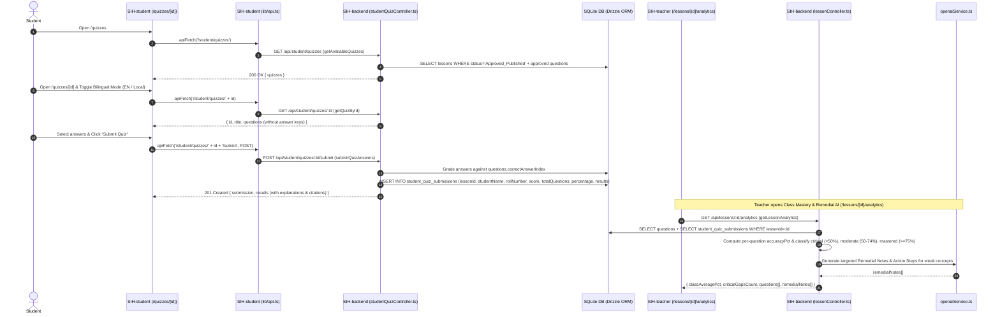
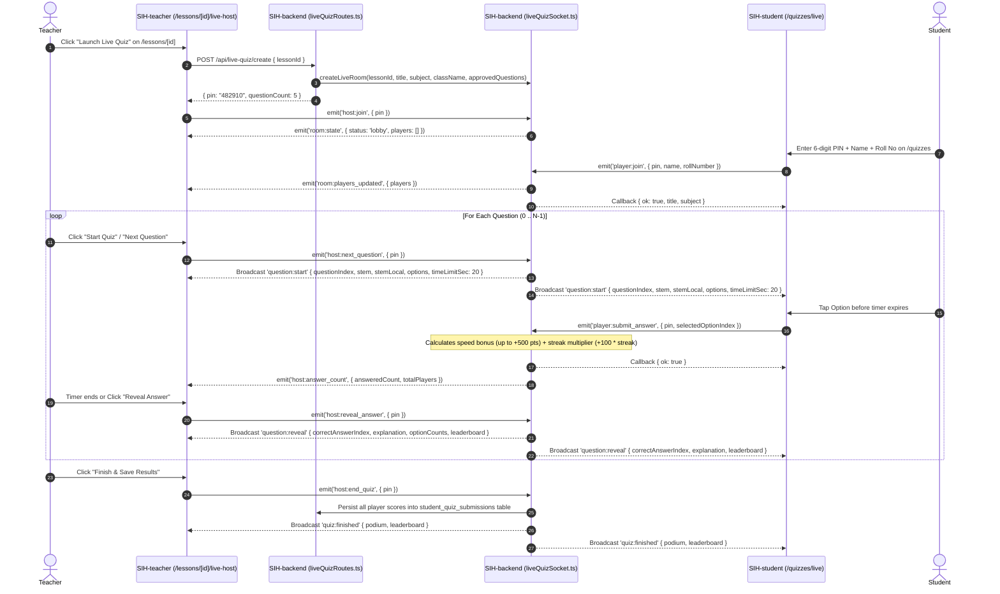

# ClasePulse — Student Portal (`SIH-student`)

Modern, interactive student learning portal built with **Next.js 15 (App Router)**, **React 19**, and **Tailwind CSS**.

---

## 🚀 Overview

The ClassPulse Student Portal provides an engaging learning workspace featuring:
- **Diagnostic Testing & Onboarding**: Adaptive student assessment flows (`/diagnostic`, `/join`, `/login`).
- **Interactive Quizzes**: Live multiplayer quiz lobbies, countdowns, question engines, and real-time leaderboards (`/quizzes`, `/quizzes/[id]/live`, `/quizzes/[id]/leaderboard`).
- **Coursework & Assignments**: Track assignments, tests, and academic progress (`/assignments`, `/tests`).
- **Student Profile & Guardian View**: Comprehensive performance metrics and guardian transparency (`/profile`, `/guardians`).

---

## 🛠️ Tech Stack

- **Framework**: Next.js 15 (App Router)
- **Library**: React 19 / TypeScript
- **Styling**: Tailwind CSS / PostCSS
- **Database / Backend**: Supabase integration (`lib/supabase.ts`)
- **Icons / UI**: Lucide React

---

## 💻 Getting Started

### 1. Install Dependencies
```bash
npm install
```

### 2. Run Development Server
```bash
npm run dev
```

Open [http://localhost:3000](http://localhost:3000) in your browser.

### 3. Build for Production
```bash
npm run build
npm start
```

---

## 📁 Project Structure

```
SIH-student/
├── app/                  # Next.js App Router routes & pages
│   ├── assignments/      # Student assignments view
│   ├── diagnostic/       # Diagnostic assessment flow
│   ├── guardians/        # Guardian & parent portal
│   ├── join/             # Class joining & onboarding
│   ├── login/            # Student authentication
│   ├── profile/          # Student profile & stats
│   ├── quizzes/          # Live quiz lobby, gameplay & leaderboard
│   ├── tests/            # Test schedule & history
│   ├── globals.css       # Global styles & theme tokens
│   └── layout.tsx        # Root layout with typography
├── components/           # Reusable UI components (DashboardShell, etc.)
├── lib/                  # API clients and utilities (Supabase, diagnosticApi)
├── public/               # Static assets & SVG icons
├── next.config.ts        # Next.js configuration
├── tsconfig.json         # TypeScript configuration
└── package.json          # Project dependencies & scripts
```


---

## 🏗️ Complete System Architecture & Data Flow (`Admin ⇄ Teacher ⇄ Student ⇄ Backend`)

### 1. System Topology & Page-to-Page Navigation (`flowchart TD`)

```mermaid
flowchart TD
    subgraph AdminPortal["SIH-admin (:5171)"]
        A_Login["/login (Admin Login)"]
        A_Overview["/overview (School KPIs)"]
        A_Classrooms["/classrooms (Sections & Join Codes)"]
        A_Teachers["/teachers (Faculty Directory)"]
        A_Students["/students (Student Directory)"]
        A_Timetable["/timetable (Master Schedule)"]
        A_Settings["/settings (AI Model Routing)"]
    end

    subgraph TeacherPortal["SIH-teacher (:3000)"]
        T_Login["/login (Teacher Login)"]
        T_Home["/ (Dashboard & KPIs)"]
        T_Record["/record-transcribe (Live Mic + Upload)"]
        T_NewLesson["/lessons/new (Multi-Modal Lesson Creator)"]
        T_LessonDetail["/lessons/[id] (Transcript, Quiz & Assignment Editor)"]
        T_LiveHost["/lessons/[id]/live-host (Socket.IO Quiz Host)"]
        T_Analytics["/lessons/[id]/analytics (Mastery Heatmap & Remedial AI)"]
        T_PrevClasses["/previous-classes (Audio Replay & Archive)"]
        T_Timetable["/timetable (Faculty Weekly Grid)"]
        T_Circles["/classes-circle (Fast Test & Student Circles)"]
    end

    subgraph StudentPortal["SIH-student (:3001)"]
        S_Login["/login (Roll No / OTP Login)"]
        S_Dash["/dashboard (Student Home)"]
        S_Join["/join (Join Class via 6-Char Code)"]
        S_Quizzes["/quizzes (Quiz Hub & Live PIN Entry)"]
        S_QuizPlay["/quizzes/[id] (Bilingual Self-Paced Quiz)"]
        S_LiveArena["/quizzes/live (Socket.IO Live Quiz Player)"]
        S_Assign["/assignments (Homework & Deadlines)"]
        S_Guardians["/guardians (Parent Alert Contacts)"]
    end

    subgraph BackendAPI["SIH-backend (:5000)"]
        R_Auth["/api/auth/* (authRoutes.ts)"]
        R_Admin["/api/admin/* (adminRoutes.ts)"]
        R_Lessons["/api/lessons/* (lessonRoutes.ts)"]
        R_Questions["/api/questions/* (questionRoutes.ts)"]
        R_Student["/api/student/* (studentRoutes.ts)"]
        R_LiveQuiz["/api/live-quiz/* + Socket.IO (liveQuizSocket.ts)"]
    end

    subgraph Database["SQLite + Drizzle ORM (sqlite.db)"]
        DB_Tables[("users | sections | lessons | questions | assignments | student_quiz_submissions")]
    end

    A_Login --> R_Auth
    A_Overview & A_Classrooms & A_Teachers & A_Students & A_Timetable & A_Settings --> R_Admin
    T_Login --> R_Auth
    T_Home & T_Record & T_NewLesson & T_LessonDetail & T_Analytics & T_PrevClasses --> R_Lessons
    T_LessonDetail --> R_Questions
    T_LiveHost <--> R_LiveQuiz
    T_Timetable & T_Circles --> R_Admin
    S_Login & S_Dash & S_Join & S_Quizzes & S_QuizPlay & S_Assign & S_Guardians --> R_Student
    S_LiveArena <--> R_LiveQuiz
    R_Auth & R_Admin & R_Lessons & R_Questions & R_Student & R_LiveQuiz <--> DB_Tables
```



---

### 2. Student Quiz Submission ➔ Teacher Analytics & Remedial AI Flow (`sequenceDiagram`)



---

### 3. Real-Time Live Gamified Quiz Flow (`Socket.IO` + REST)



---

### 4. Student Portal Page-to-Function-to-Backend Matrix

| Page | Frontend Function (`lib/api.ts`) | Backend Endpoint | Backend Handler | State / DB Table |
| :--- | :--- | :--- | :--- | :--- |
| `/login` | `loginWithPassword()`, `requestOtp()`, `verifyOtp()` | `POST /api/student/auth/*` | `studentRoutes.ts` | Student JWT session |
| `/dashboard` | `apiFetch('/student/enrollments')`, `apiFetch('/student/quizzes')`, `apiFetch('/student/assignments')` | `GET /api/student/enrollments`, `/quizzes`, `/assignments` | `studentRoutes.ts` & `studentQuizController.ts` | `sections`, `lessons`, `assignments` |
| `/join` | `apiFetch('/student/sections')`, `apiFetch('/student/enrollments', POST)` | `GET /api/student/sections`, `POST /api/student/enrollments` | `studentRoutes.ts` | Verifies 6-char `joinCode` & increments `sections.studentCount` |
| `/quizzes` & `/quizzes/[id]` | `apiFetch('/student/quizzes/:id')`, `apiFetch('/student/quizzes/:id/submit', POST)` | `GET /api/student/quizzes/:id`, `POST /api/student/quizzes/:id/submit` | `getQuizById`, `submitQuizAnswers` | Grades answers & inserts into `student_quiz_submissions` |
| `/quizzes/live` | Socket.IO `player:join`, `player:submit_answer` | `ws://localhost:5000` | `initLiveQuizSocket` | Real-time gameplay & leaderboard |
| `/assignments` | `apiFetch('/student/assignments')` | `GET /api/student/assignments` | `studentRoutes.ts` | `assignments` |
| `/guardians` | `apiFetch('/student/guardians', GET/POST/DELETE)` | `GET/POST/DELETE /api/student/guardians` | `studentRoutes.ts` | `studentGuardians` |
