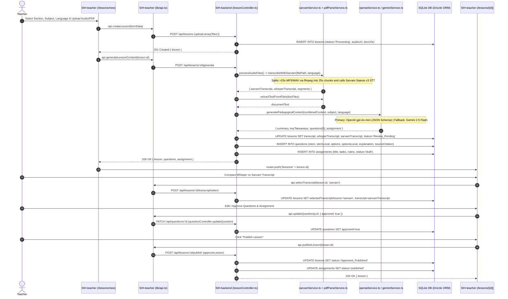
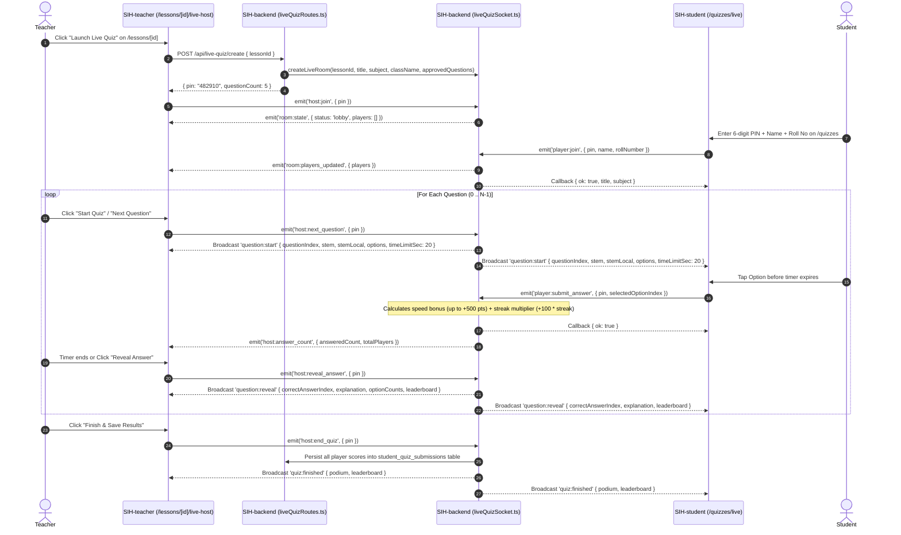

# ClasePulse — Teacher Portal (`SIH-teacher`)

Modern educator workflow and lesson synthesis portal built with **Next.js 15 (App Router)**, **React 19**, and **TypeScript**.

---

## 🚀 Overview

The ClassPulse Teacher Portal empowers educators with:
- **Audio & Multimodal Lesson Ingestion**: Record classroom audio directly (`components/AudioRecorder.tsx`) or import study materials (`components/SourcePicker.tsx`).
- **Automated Lesson Processing & Synthesis**: Generate synthesized lecture summaries, key concepts, and structured study guides (`app/lessons/new`, `app/lessons/[id]`).
- **Interactive Question Generation & Review**: Review, edit, and fine-tune AI-generated questions and assignments with difficulty scaling (`app/lessons/[id]/review`).
- **Teacher Workspace & Dashboard**: Manage classes, review analytics, and monitor section readiness (`app/lessons`, `components/HeaderNav.tsx`).

---

## 🛠️ Tech Stack

- **Framework**: Next.js 15 (App Router)
- **Library**: React 19 / TypeScript
- **Styling**: Vanilla CSS / Responsive Layout (`app/globals.css`)
- **API Client**: Strongly-typed lesson API (`lib/api.ts`, `types/index.ts`)

---

## 💻 Getting Started

### 1. Install Dependencies
```bash
npm install
```

### 2. Run Development Server
```bash
npm run dev
```

Open [http://localhost:3000](http://localhost:3000) in your browser.

### 3. Build for Production
```bash
npm run build
npm start
```

---

## 📁 Project Structure

```
SIH-teacher/
├── app/                  # Next.js App Router routes & pages
│   ├── lessons/          # Lesson listing, creation, and review
│   │   ├── [id]/         # Lesson details and review pages
│   │   └── new/          # New lesson audio & source ingestion
│   ├── globals.css       # Global styles & layout rules
│   ├── layout.tsx        # Root layout with HeaderNav
│   └── page.tsx          # Landing redirect to /lessons
├── components/           # Core UI components (AudioRecorder, SourcePicker, HeaderNav)
├── lib/                  # Application API client and mock data layer
├── types/                # TypeScript interfaces and domain models
├── public/               # Static assets & SVG icons
├── src/                  # Legacy screen references and modular components
├── next.config.mjs       # Next.js configuration
├── tsconfig.json         # TypeScript configuration
└── package.json          # Project dependencies & scripts
```


---

## 🏗️ Complete System Architecture & Data Flow (`Admin ⇄ Teacher ⇄ Student ⇄ Backend`)

### 1. System Topology & Page-to-Page Navigation (`flowchart TD`)

```mermaid
flowchart TD
    subgraph AdminPortal["SIH-admin (:5171)"]
        A_Login["/login (Admin Login)"]
        A_Overview["/overview (School KPIs)"]
        A_Classrooms["/classrooms (Sections & Join Codes)"]
        A_Teachers["/teachers (Faculty Directory)"]
        A_Students["/students (Student Directory)"]
        A_Timetable["/timetable (Master Schedule)"]
        A_Settings["/settings (AI Model Routing)"]
    end

    subgraph TeacherPortal["SIH-teacher (:3000)"]
        T_Login["/login (Teacher Login)"]
        T_Home["/ (Dashboard & KPIs)"]
        T_Record["/record-transcribe (Live Mic + Upload)"]
        T_NewLesson["/lessons/new (Multi-Modal Lesson Creator)"]
        T_LessonDetail["/lessons/[id] (Transcript, Quiz & Assignment Editor)"]
        T_LiveHost["/lessons/[id]/live-host (Socket.IO Quiz Host)"]
        T_Analytics["/lessons/[id]/analytics (Mastery Heatmap & Remedial AI)"]
        T_PrevClasses["/previous-classes (Audio Replay & Archive)"]
        T_Timetable["/timetable (Faculty Weekly Grid)"]
        T_Circles["/classes-circle (Fast Test & Student Circles)"]
    end

    subgraph StudentPortal["SIH-student (:3001)"]
        S_Login["/login (Roll No / OTP Login)"]
        S_Dash["/dashboard (Student Home)"]
        S_Join["/join (Join Class via 6-Char Code)"]
        S_Quizzes["/quizzes (Quiz Hub & Live PIN Entry)"]
        S_QuizPlay["/quizzes/[id] (Bilingual Self-Paced Quiz)"]
        S_LiveArena["/quizzes/live (Socket.IO Live Quiz Player)"]
        S_Assign["/assignments (Homework & Deadlines)"]
        S_Guardians["/guardians (Parent Alert Contacts)"]
    end

    subgraph BackendAPI["SIH-backend (:5000)"]
        R_Auth["/api/auth/* (authRoutes.ts)"]
        R_Admin["/api/admin/* (adminRoutes.ts)"]
        R_Lessons["/api/lessons/* (lessonRoutes.ts)"]
        R_Questions["/api/questions/* (questionRoutes.ts)"]
        R_Student["/api/student/* (studentRoutes.ts)"]
        R_LiveQuiz["/api/live-quiz/* + Socket.IO (liveQuizSocket.ts)"]
    end

    subgraph AIServices["AI & Media Pipeline (src/services/)"]
        SVC_FFmpeg["ffmpeg (16kHz Mono 25s Chunker)"]
        SVC_Sarvam["sarvamService.ts (Saaras v3 STT)"]
        SVC_OpenAI["openaiService.ts (GPT-4o-mini / Whisper)"]
        SVC_Gemini["geminiService.ts (Gemini 2.5 Flash Fallback)"]
        SVC_PDF["pdfParseService.ts (PDF/DOCX Extractor)"]
    end

    subgraph Database["SQLite + Drizzle ORM (sqlite.db)"]
        DB_Tables[("users | sections | lessons | questions | assignments | student_quiz_submissions")]
    end

    A_Login --> R_Auth
    A_Overview & A_Classrooms & A_Teachers & A_Students & A_Timetable & A_Settings --> R_Admin

    T_Login --> R_Auth
    T_Home & T_Record & T_NewLesson & T_LessonDetail & T_Analytics & T_PrevClasses --> R_Lessons
    T_LessonDetail --> R_Questions
    T_LiveHost <--> R_LiveQuiz
    T_Timetable & T_Circles --> R_Admin

    S_Login & S_Dash & S_Join & S_Quizzes & S_QuizPlay & S_Assign & S_Guardians --> R_Student
    S_LiveArena <--> R_LiveQuiz

    R_Lessons --> SVC_FFmpeg --> SVC_Sarvam
    R_Lessons --> SVC_PDF
    R_Lessons --> SVC_OpenAI & SVC_Gemini

    R_Auth & R_Admin & R_Lessons & R_Questions & R_Student & R_LiveQuiz <--> DB_Tables
```



---

### 2. Lecture Ingestion ➔ AI Pipeline ➔ Teacher Review ➔ Publish (`sequenceDiagram`)



---

### 3. Real-Time Live Gamified Quiz Flow (`Socket.IO` + REST)



---

### 4. Teacher Portal Page-to-Function-to-Backend Matrix

| Page | Frontend Function (`lib/api.ts`) | Backend Endpoint | Backend Handler & Services | State / DB Table |
| :--- | :--- | :--- | :--- | :--- |
| `/login` | `api.login()` | `POST /api/auth/login` | `authController.login` | `users` |
| `/` | `api.getLessons()` | `GET /api/lessons` | `lessonController.getLessons` | `lessons`, `questions`, `assignments` |
| `/record-transcribe` & `/lessons/new` | `api.createLesson()` ➔ `api.generateLessonContent()` | `POST /api/lessons` ➔ `POST /api/lessons/:id/generate` | `createLesson` ➔ `generateLessonContent` ➔ `transcribeWithSarvam` ➔ `generatePedagogicalContent` | `lessons`, `questions`, `assignments` |
| `/lessons/[id]` | `api.getLessonById()`, `api.selectTranscript()`, `api.updateQuestion()`, `api.updateAssignment()`, `api.publishLesson()` | `GET /api/lessons/:id`, `POST /api/lessons/:id/transcript/select`, `PATCH /api/questions/:id`, `PATCH /api/lessons/:id/assignment`, `POST /api/lessons/:id/publish` | `getLessonById`, `selectTranscript`, `updateQuestion`, `updateLessonAssignment`, `approveLesson` | `lessons`, `questions`, `assignments` |
| `/lessons/[id]/live-host` | `api.createLiveQuizSession()` + Socket.IO `host:*` | `POST /api/live-quiz/create` + `ws://localhost:5000` | `liveQuizRoutes.ts` + `initLiveQuizSocket` | Live rooms + `student_quiz_submissions` |
| `/lessons/[id]/analytics` | `api.getLessonAnalytics()` | `GET /api/lessons/:id/analytics` | `lessonController.getLessonAnalytics` | `questions`, `student_quiz_submissions` |
| `/previous-classes` | `api.getLessonsPage()`, `api.getLessonAudioUrl()` | `GET /api/lessons?page=1`, `GET /api/lessons/:id/audio` | `getLessons`, `streamLessonAudio` | Streams audio from `uploads/` |
| `/timetable` & `/classes-circle` | `api.getTimetables()`, `api.getStudents()`, `api.createStudent()` | `GET /api/admin/timetables`, `GET/POST /api/admin/students` | `adminRoutes.ts` | Synced with Admin Console |
