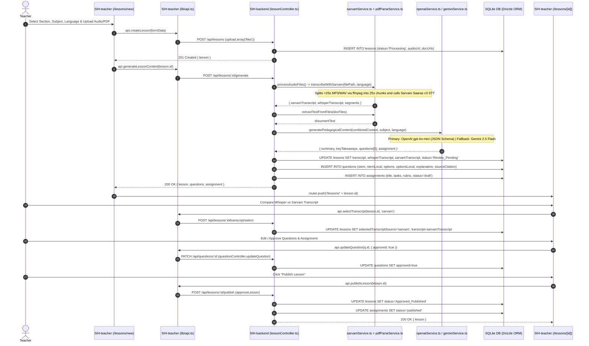
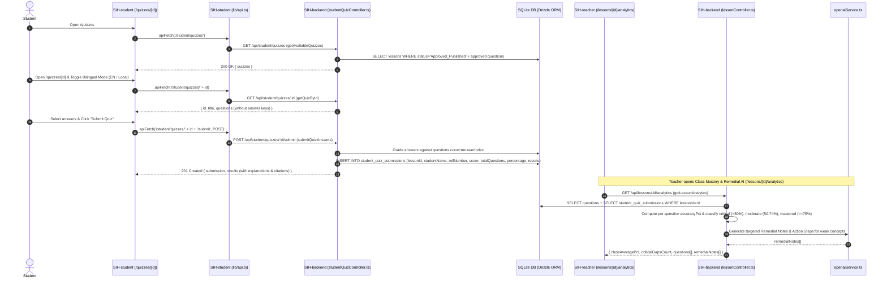
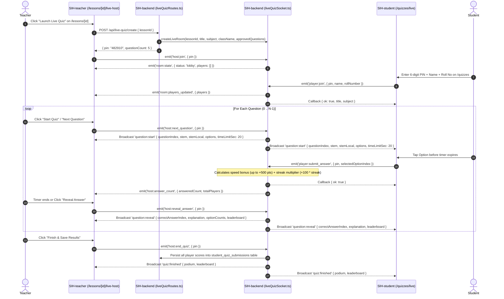
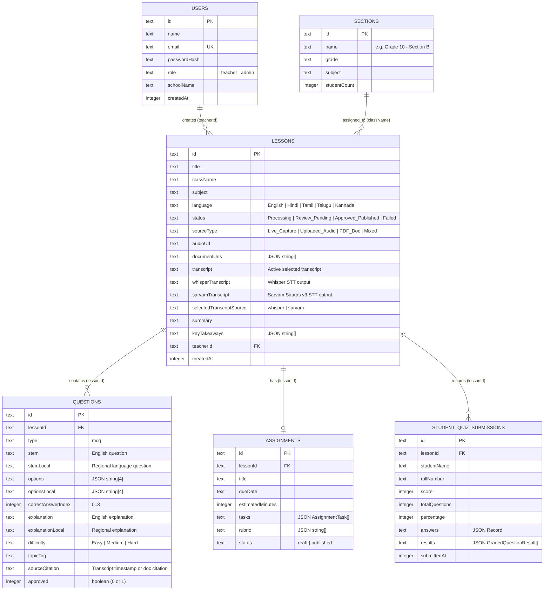

# SIH-backend — ClassPulse unified backend (MongoDB)

Express + MongoDB backend for the teacher/student dashboards, now integrated
with the **lecture pipeline** sidecar: teacher audio uploads are transcribed
(Sarvam batch STT), refined, and turned into quiz questions + summaries by the
pipeline — questions land in the `Question` collection for teacher review.

## The flow

```
Teacher dashboard          SIH-backend                    Pipeline sidecar
─────────────────       ───────────────────          ────────────────────────
lessons/new ──────────▶ POST /api/lessons (draft)
                        POST /api/lessons/:id/source  (upload → /uploads)
                        POST /api/lessons/:id/generate ──▶ status: queued
                           (background job) ──────────────▶ POST /v1/ingest/audio-file
                        polls status:
                          transcribing  ◀── Sarvam batch STT
                          generating    ◀── refinement + knowledge + quiz
                          validating    ◀── question mapping
                        ready_for_review ◀── questions in Mongo
review page ──────────▶ approve/edit questions ──▶ POST /api/lessons/:id/approve
                                                     status: published
Student dashboard ────▶ GET /api/student/quizzes            (published lessons)
                       GET /api/student/quizzes/:id         (quiz w/o answers)
                       POST /api/student/quizzes/:id/submit (server-side grading)
```

## Run order (3 terminals)

```bash
# 1. Pipeline sidecar (terminal 1, from the pipeline repo)
cp .env.example .env    # set STT_PROVIDER=cloud-sarvam, SARVAM_API_KEY,
                        # LLM_PROVIDER=openai, OPENAI_API_KEY, EMBED_API_KEY
npm install && npm run prisma:push && npm run dev

# 2. This backend (terminal 2)
cp .env.example .env    # set PIPELINE_API_KEY = the pipeline's EMBED_API_KEY
npm install && npm run dev

# 3. Dashboards (terminals 3+4)
cd ../SIH-teacher && npm run dev    # :3000
cd ../SIH-student && npm run dev    # :3001
```

## Pipeline-specific env

| Variable | Default | Purpose |
|---|---|---|
| `PIPELINE_URL` | `http://localhost:4000` | Pipeline API base URL |
| `PIPELINE_API_KEY` | — | The pipeline's `EMBED_API_KEY` (server-side only) |

`GET /api/health` reports `pipeline: { ok, detail }` connectivity.

## New endpoints

| Route | Purpose |
|---|---|
| `GET /api/student/quizzes` | Published lesson quizzes for the student dashboard |
| `GET /api/student/quizzes/:lessonId` | Quiz payload (no correct answers) |
| `POST /api/student/quizzes/:lessonId/submit` | Server-side grading (MCQ + keyword-overlap for short answers) |
| `POST /api/lessons/:id/generate` | Now runs the **real** pipeline job (202, async) |
| `POST /api/lessons/:id/approve` | Publishes (requires ≥1 approved question) |

## Notes

- `Question.sourceCitation` carries the lecture timestamp (`MM:SS–MM:SS`) the
  question was generated from — shown to students in the results view.
- Only `approved` questions reach students; publish requires ≥1 approved.
- Generation failures land in `lesson.status='failed'` + `failureReason`
  (the teacher dashboard already renders this state).


---

## 🏗️ Complete System Architecture & Data Flow (`Admin ⇄ Teacher ⇄ Student ⇄ Backend`)

### 1. System Topology & Page-to-Page Navigation (`flowchart TD`)

```mermaid
flowchart TD
    subgraph AdminPortal["SIH-admin (:5171)"]
        A_Login["/login (Admin Login)"]
        A_Overview["/overview (School KPIs)"]
        A_Classrooms["/classrooms (Sections & Join Codes)"]
        A_Teachers["/teachers (Faculty Directory)"]
        A_Students["/students (Student Directory)"]
        A_Timetable["/timetable (Master Schedule)"]
        A_Settings["/settings (AI Model Routing)"]
    end

    subgraph TeacherPortal["SIH-teacher (:3000)"]
        T_Login["/login (Teacher Login)"]
        T_Home["/ (Dashboard & KPIs)"]
        T_Record["/record-transcribe (Live Mic + Upload)"]
        T_NewLesson["/lessons/new (Multi-Modal Lesson Creator)"]
        T_LessonDetail["/lessons/[id] (Transcript, Quiz & Assignment Editor)"]
        T_LiveHost["/lessons/[id]/live-host (Socket.IO Quiz Host)"]
        T_Analytics["/lessons/[id]/analytics (Mastery Heatmap & Remedial AI)"]
        T_PrevClasses["/previous-classes (Audio Replay & Archive)"]
        T_Timetable["/timetable (Faculty Weekly Grid)"]
        T_Circles["/classes-circle (Fast Test & Student Circles)"]
    end

    subgraph StudentPortal["SIH-student (:3001)"]
        S_Login["/login (Roll No / OTP Login)"]
        S_Dash["/dashboard (Student Home)"]
        S_Join["/join (Join Class via 6-Char Code)"]
        S_Quizzes["/quizzes (Quiz Hub & Live PIN Entry)"]
        S_QuizPlay["/quizzes/[id] (Bilingual Self-Paced Quiz)"]
        S_LiveArena["/quizzes/live (Socket.IO Live Quiz Player)"]
        S_Assign["/assignments (Homework & Deadlines)"]
        S_Guardians["/guardians (Parent Alert Contacts)"]
    end

    subgraph BackendAPI["SIH-backend (:5000)"]
        R_Auth["/api/auth/* (authRoutes.ts)"]
        R_Admin["/api/admin/* (adminRoutes.ts)"]
        R_Lessons["/api/lessons/* (lessonRoutes.ts)"]
        R_Questions["/api/questions/* (questionRoutes.ts)"]
        R_Student["/api/student/* (studentRoutes.ts)"]
        R_LiveQuiz["/api/live-quiz/* + Socket.IO (liveQuizSocket.ts)"]
    end

    subgraph AIServices["AI & Media Pipeline (src/services/)"]
        SVC_FFmpeg["ffmpeg (16kHz Mono 25s Chunker)"]
        SVC_Sarvam["sarvamService.ts (Saaras v3 STT)"]
        SVC_OpenAI["openaiService.ts (GPT-4o-mini / Whisper)"]
        SVC_Gemini["geminiService.ts (Gemini 2.5 Flash Fallback)"]
        SVC_PDF["pdfParseService.ts (PDF/DOCX Extractor)"]
    end

    subgraph Database["SQLite + Drizzle ORM (sqlite.db)"]
        DB_Tables[("users | sections | lessons | questions | assignments | student_quiz_submissions")]
    end

    A_Login --> R_Auth
    A_Overview & A_Classrooms & A_Teachers & A_Students & A_Timetable & A_Settings --> R_Admin

    T_Login --> R_Auth
    T_Home & T_Record & T_NewLesson & T_LessonDetail & T_Analytics & T_PrevClasses --> R_Lessons
    T_LessonDetail --> R_Questions
    T_LiveHost <--> R_LiveQuiz
    T_Timetable & T_Circles --> R_Admin

    S_Login & S_Dash & S_Join & S_Quizzes & S_QuizPlay & S_Assign & S_Guardians --> R_Student
    S_LiveArena <--> R_LiveQuiz

    R_Lessons --> SVC_FFmpeg --> SVC_Sarvam
    R_Lessons --> SVC_PDF
    R_Lessons --> SVC_OpenAI & SVC_Gemini

    R_Auth & R_Admin & R_Lessons & R_Questions & R_Student & R_LiveQuiz <--> DB_Tables
```



---

### 2. Lecture Ingestion ➔ AI Pipeline ➔ Teacher Review ➔ Publish (`sequenceDiagram`)



---

### 3. Student Quiz Submission ➔ Teacher Analytics & Remedial AI Flow (`sequenceDiagram`)



---

### 4. Real-Time Live Gamified Quiz Flow (`Socket.IO` + REST)



---

### 5. Database Schema & Entity-Relationship Diagram (`erDiagram`)



---

### 6. Complete Page-to-Function-to-Endpoint Reference Matrix

#### Admin Portal (`SIH-admin` — Port `5171`)
| Page | Frontend Function | Backend Endpoint | Backend Handler | State / DB Table |
| :--- | :--- | :--- | :--- | :--- |
| `/login` | `AuthContext.login()` | `POST /api/auth/login` | `authController.login` | `users` |
| `/overview` | `apiFetch('/admin/overview')` | `GET /api/admin/overview` | `adminRoutes.ts` | Aggregates `sections`, `users`, `lessons`, `questions`, `student_quiz_submissions` |
| `/classrooms` | `createSection()`, `saveEdit()`, `removeSection()`, `regenerateJoinCode()` | `GET/POST/PATCH/DELETE /api/admin/sections` | `adminRoutes.ts` | `sections` + `sectionMeta` (`joinCode`, `room`) |
| `/teachers` | `createTeacher()`, `deleteTeacher()` | `GET/POST/DELETE /api/admin/teachers` | `adminRoutes.ts` | `users` |
| `/students` | `createStudent()`, `deleteStudent()` | `GET/POST/DELETE /api/admin/students` | `adminRoutes.ts` | `extraStudents` + `sections.studentCount` |
| `/timetable` | `saveCell()`, `persistTimetable()` | `GET/PUT /api/admin/timetables` | `adminRoutes.ts` | `storedTimetables` (synced with Teacher `/timetable`) |
| `/settings` | `saveModels()` | `GET/PATCH /api/admin/settings/models` | `adminRoutes.ts` | `modelSettings` (`sttPrimary`, `llmPrimary`, `ttsProvider`) |

#### Teacher Portal (`SIH-teacher` — Port `3000`)
| Page | Frontend Function (`lib/api.ts`) | Backend Endpoint | Backend Handler & Services | State / DB Table |
| :--- | :--- | :--- | :--- | :--- |
| `/login` | `api.login()` | `POST /api/auth/login` | `authController.login` | `users` |
| `/` | `api.getLessons()` | `GET /api/lessons` | `lessonController.getLessons` | `lessons`, `questions`, `assignments` |
| `/record-transcribe` & `/lessons/new` | `api.createLesson()` ➔ `api.generateLessonContent()` | `POST /api/lessons` ➔ `POST /api/lessons/:id/generate` | `createLesson` ➔ `generateLessonContent` ➔ `transcribeWithSarvam` ➔ `generatePedagogicalContent` | `lessons`, `questions`, `assignments` |
| `/lessons/[id]` | `api.getLessonById()`, `api.selectTranscript()`, `api.updateQuestion()`, `api.updateAssignment()`, `api.publishLesson()` | `GET /api/lessons/:id`, `POST /api/lessons/:id/transcript/select`, `PATCH /api/questions/:id`, `PATCH /api/lessons/:id/assignment`, `POST /api/lessons/:id/publish` | `getLessonById`, `selectTranscript`, `updateQuestion`, `updateLessonAssignment`, `approveLesson` | `lessons`, `questions`, `assignments` |
| `/lessons/[id]/live-host` | `api.createLiveQuizSession()` + Socket.IO `host:*` | `POST /api/live-quiz/create` + `ws://localhost:5000` | `liveQuizRoutes.ts` + `initLiveQuizSocket` | Live rooms + `student_quiz_submissions` |
| `/lessons/[id]/analytics` | `api.getLessonAnalytics()` | `GET /api/lessons/:id/analytics` | `lessonController.getLessonAnalytics` | `questions`, `student_quiz_submissions` |
| `/previous-classes` | `api.getLessonsPage()`, `api.getLessonAudioUrl()` | `GET /api/lessons?page=1`, `GET /api/lessons/:id/audio` | `getLessons`, `streamLessonAudio` | Streams audio from `uploads/` |
| `/timetable` & `/classes-circle` | `api.getTimetables()`, `api.getStudents()`, `api.createStudent()` | `GET /api/admin/timetables`, `GET/POST /api/admin/students` | `adminRoutes.ts` | Synced with Admin Console |

#### Student Portal (`SIH-student` — Port `3001`)
| Page | Frontend Function (`lib/api.ts`) | Backend Endpoint | Backend Handler | State / DB Table |
| :--- | :--- | :--- | :--- | :--- |
| `/login` | `loginWithPassword()`, `requestOtp()`, `verifyOtp()` | `POST /api/student/auth/*` | `studentRoutes.ts` | Student JWT session |
| `/dashboard` | `apiFetch('/student/enrollments')`, `apiFetch('/student/quizzes')`, `apiFetch('/student/assignments')` | `GET /api/student/enrollments`, `/quizzes`, `/assignments` | `studentRoutes.ts` & `studentQuizController.ts` | `sections`, `lessons`, `assignments` |
| `/join` | `apiFetch('/student/sections')`, `apiFetch('/student/enrollments', POST)` | `GET /api/student/sections`, `POST /api/student/enrollments` | `studentRoutes.ts` | Verifies 6-char `joinCode` & increments `sections.studentCount` |
| `/quizzes` & `/quizzes/[id]` | `apiFetch('/student/quizzes/:id')`, `apiFetch('/student/quizzes/:id/submit', POST)` | `GET /api/student/quizzes/:id`, `POST /api/student/quizzes/:id/submit` | `getQuizById`, `submitQuizAnswers` | Grades answers & inserts into `student_quiz_submissions` |
| `/quizzes/live` | Socket.IO `player:join`, `player:submit_answer` | `ws://localhost:5000` | `initLiveQuizSocket` | Real-time gameplay & leaderboard |
| `/assignments` | `apiFetch('/student/assignments')` | `GET /api/student/assignments` | `studentRoutes.ts` | `assignments` |
| `/guardians` | `apiFetch('/student/guardians', GET/POST/DELETE)` | `GET/POST/DELETE /api/student/guardians` | `studentRoutes.ts` | `studentGuardians` |
