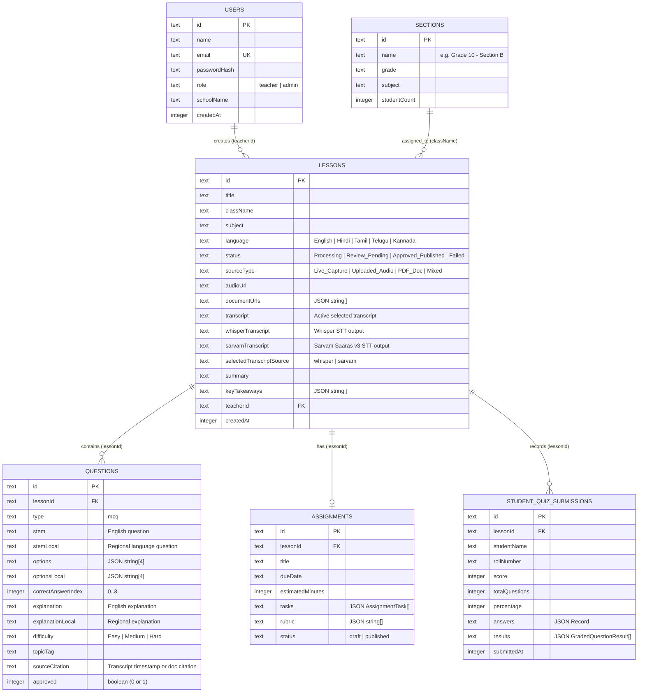

# ClassPulse Admin

Next.js 15 (App Router) + Tailwind CSS 3.4 front-end for the ClassPulse admin, teacher and student portals.

- `npm run dev` — start the dev server (role selected via `NEXT_PUBLIC_APP_ROLE`)
- `npm run build` — production build
- Design system: see `DESIGN.md` (Editorial Brutalist / Swiss monochrome). Product context: `PRODUCT.md`.

---

## 🏗️ Complete System Architecture & Data Flow (`Admin ⇄ Teacher ⇄ Student ⇄ Backend`)

### 1. System Topology & Page-to-Page Navigation (`flowchart TD`)

```mermaid
flowchart TD
    subgraph AdminPortal["SIH-admin (:5171)"]
        A_Login["/login (Admin Login)"]
        A_Overview["/overview (School KPIs)"]
        A_Classrooms["/classrooms (Sections & Join Codes)"]
        A_Teachers["/teachers (Faculty Directory)"]
        A_Students["/students (Student Directory)"]
        A_Timetable["/timetable (Master Schedule)"]
        A_Settings["/settings (AI Model Routing)"]
    end

    subgraph TeacherPortal["SIH-teacher (:3000)"]
        T_Login["/login (Teacher Login)"]
        T_Home["/ (Dashboard & KPIs)"]
        T_Record["/record-transcribe (Live Mic + Upload)"]
        T_NewLesson["/lessons/new (Multi-Modal Lesson Creator)"]
        T_LessonDetail["/lessons/[id] (Transcript, Quiz & Assignment Editor)"]
        T_LiveHost["/lessons/[id]/live-host (Socket.IO Quiz Host)"]
        T_Analytics["/lessons/[id]/analytics (Mastery Heatmap & Remedial AI)"]
        T_PrevClasses["/previous-classes (Audio Replay & Archive)"]
        T_Timetable["/timetable (Faculty Weekly Grid)"]
        T_Circles["/classes-circle (Fast Test & Student Circles)"]
    end

    subgraph StudentPortal["SIH-student (:3001)"]
        S_Login["/login (Roll No / OTP Login)"]
        S_Dash["/dashboard (Student Home)"]
        S_Join["/join (Join Class via 6-Char Code)"]
        S_Quizzes["/quizzes (Quiz Hub & Live PIN Entry)"]
        S_QuizPlay["/quizzes/[id] (Bilingual Self-Paced Quiz)"]
        S_LiveArena["/quizzes/live (Socket.IO Live Quiz Player)"]
        S_Assign["/assignments (Homework & Deadlines)"]
        S_Guardians["/guardians (Parent Alert Contacts)"]
    end

    subgraph BackendAPI["SIH-backend (:5000)"]
        R_Auth["/api/auth/* (authRoutes.ts)"]
        R_Admin["/api/admin/* (adminRoutes.ts)"]
        R_Lessons["/api/lessons/* (lessonRoutes.ts)"]
        R_Questions["/api/questions/* (questionRoutes.ts)"]
        R_Student["/api/student/* (studentRoutes.ts)"]
        R_LiveQuiz["/api/live-quiz/* + Socket.IO (liveQuizSocket.ts)"]
    end

    subgraph Database["SQLite + Drizzle ORM (sqlite.db)"]
        DB_Tables[("users | sections | lessons | questions | assignments | student_quiz_submissions")]
    end

    A_Login --> R_Auth
    A_Overview & A_Classrooms & A_Teachers & A_Students & A_Timetable & A_Settings --> R_Admin
    T_Login --> R_Auth
    T_Home & T_Record & T_NewLesson & T_LessonDetail & T_Analytics & T_PrevClasses --> R_Lessons
    T_LessonDetail --> R_Questions
    T_LiveHost <--> R_LiveQuiz
    T_Timetable & T_Circles --> R_Admin
    S_Login & S_Dash & S_Join & S_Quizzes & S_QuizPlay & S_Assign & S_Guardians --> R_Student
    S_LiveArena <--> R_LiveQuiz
    R_Auth & R_Admin & R_Lessons & R_Questions & R_Student & R_LiveQuiz <--> DB_Tables
```

---

### 2. Database Schema & Entity-Relationship Diagram (`erDiagram`)

---

### 3. Admin Console Page-to-Function-to-Backend Matrix (`SIH-admin` — Port `5171`)

| Page | Frontend Function | Backend Endpoint | Backend Handler | State / DB Table |
| :--- | :--- | :--- | :--- | :--- |
| `/login` | `AuthContext.login()` | `POST /api/auth/login` | `authController.login` | `users` |
| `/overview` | `apiFetch('/admin/overview')` | `GET /api/admin/overview` | `adminRoutes.ts` | Aggregates `sections`, `users`, `lessons`, `questions`, `student_quiz_submissions` |
| `/classrooms` | `createSection()`, `saveEdit()`, `removeSection()`, `regenerateJoinCode()` | `GET/POST/PATCH/DELETE /api/admin/sections` | `adminRoutes.ts` | `sections` + `sectionMeta` (`joinCode`, `room`) |
| `/teachers` | `createTeacher()`, `deleteTeacher()` | `GET/POST/DELETE /api/admin/teachers` | `adminRoutes.ts` | `users` |
| `/students` | `createStudent()`, `deleteStudent()` | `GET/POST/DELETE /api/admin/students` | `adminRoutes.ts` | `extraStudents` + `sections.studentCount` |
| `/timetable` | `saveCell()`, `persistTimetable()` | `GET/PUT /api/admin/timetables` | `adminRoutes.ts` | `storedTimetables` (synced with Teacher `/timetable`) |
| `/settings` | `saveModels()` | `GET/PATCH /api/admin/settings/models` | `adminRoutes.ts` | `modelSettings` (`sttPrimary`, `llmPrimary`, `ttsProvider`) |
