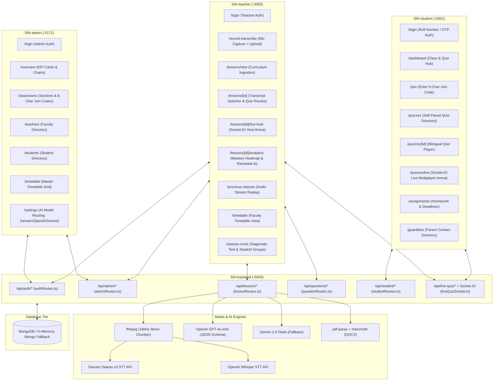
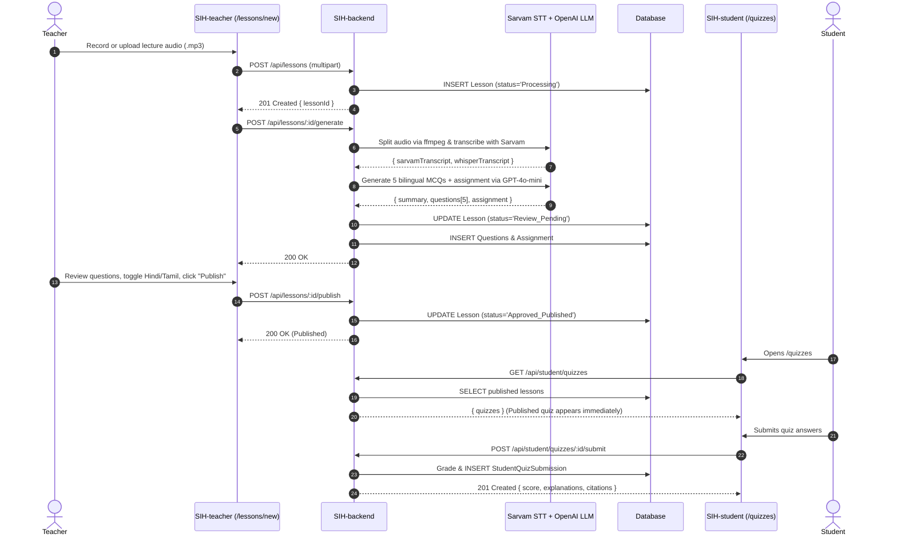

# ClassPulse — Master System Architecture & Product Requirements Document (PRD)

> **Document Purpose**: This file is a self-contained, authoritative specification of the entire ClassPulse platform across all 4 repositories (`SIH-backend`, `SIH-teacher`, `SIH-student`, and `SIH-admin`). It is designed to provide full context to an AI/GPT model for architecture reviews, refactoring, feature upgrades, and production migrations.

---

## 1. Executive Summary & Product Vision

### 1.1 What is ClassPulse?
**ClassPulse** is an AI-powered, multi-role academic synthesis and classroom engagement platform tailored for multilingual Indian education (grades 6–12 and higher education). It bridges the gap between spoken classroom lectures, structured curricular study materials, real-time gamified evaluation, and institutional administration.

### 1.2 Core Value Proposition
1. **Multimodal Lecture Ingestion**: Teachers can record live lecture audio in-browser via the MediaRecorder API, upload existing audio files (MP3/WAV/M4A), or attach reference curriculum documents (PDF/DOCX).
2. **Dual-STT Regional AI Pipeline**: Spoken lectures (often in regional languages or Hinglish/Tanglish) are split via `ffmpeg` into 25-second chunks and transcribed using **Sarvam AI (Saaras v3 STT)** with fallback to **OpenAI Whisper**. The teacher can review and switch between transcript engines.
3. **Automated Bilingual Content Generation**: Primary LLMs (**OpenAI GPT-4o-mini** with structured JSON schemas and **Google Gemini 2.5 Flash** fallback) extract lecture summaries, key takeaways, **5 bilingual multiple-choice questions (MCQs)** with timestamped lecture citations, and 1 curriculum assignment with rubric points.
4. **Interactive Teacher Review & Publishing**: Faculty can edit question stems, add distractors, toggle regional translations, approve questions, and publish the lesson.
5. **Dual Student Evaluation Loop**:
   - **Self-Paced Practice**: Students take bilingual quizzes with immediate server-side grading, explanations, and citation timestamps.
   - **Real-Time Live Gamified Arena**: Teachers launch live multiplayer quizzes via a 6-digit PIN; students join over **Socket.IO** for synchronized question countdowns, speed multipliers, streaks, and live leaderboards.
6. **Class Mastery Analytics & AI Remedial Feedback**: Question-level accuracy metrics are classified into *Critical (<50%)*, *Moderate (50–74%)*, and *Mastered (≥75%)*, triggering AI-generated remedial notes and targeted action steps for teachers.
7. **Institutional Governance & Cross-Dashboard Sync**: Administrators manage sections, 6-character student join codes (e.g. `BIO10B`), faculty rosters, student directories, weekly timetables, and global AI model provider settings.

---

## 2. System Topology & Current Repository Structure

```
x:\Projects\BenX\
├── SIH-backend/        # Express 4.21 / Node 22 API + Socket.IO + MongoDB (Port 5000)
├── SIH-teacher/        # Next.js 16.3 / React 19 / Vanilla CSS Faculty Studio (Port 3000)
├── SIH-student/        # Next.js 16.3 / React 19 / Tailwind v4 Student Portal (Port 3001)
├── SIH-admin/          # Next.js 16.3 / React 19 / Tailwind v4 Admin Console (Port 5171)
└── SYSTEM_ARCHITECTURE_PRD.md # This document
```

### 2.1 Service Ports & Networking
| Service | Tech Stack | Dev Port | Prod Port Target | Primary Responsibilities |
| :--- | :--- | :--- | :--- | :--- |
| **`SIH-backend`** | Node.js (ESM), Express 4.21, Mongoose, Socket.IO, tsx | `5000` | `5000` | REST API, Socket.IO server, Auth JWT, Multer uploads, AI services |
| **`SIH-teacher`** | Next.js 16.3.3, React 19.2.8, TypeScript, CSS Tokens | `3000` | `80 / 443` | Audio recording, transcript editor, quiz approval, live host, analytics |
| **`SIH-student`** | Next.js 16.3.3, React 19.2.8, Tailwind CSS v4 | `3001` | `80 / 443` | Self-paced quizzes, live arena player, join class, assignments, guardians |
| **`SIH-admin`** | Next.js 16.3.3, React 19.2.8, Tailwind v4, Recharts | `5171` | `80 / 443` | Section join codes, faculty/student CRUD, master timetable, AI model routing |

---

## 3. High-Level Architecture Diagram (`flowchart TD`)



---

## 4. Complete Data Models & Database Schemas

### 4.1 Primary Entities (Mongoose / Planned PostgreSQL Schema)

#### 1. `User` (Teachers & Admins)
```typescript
interface IUser {
  _id: string; // ObjectId / UUID
  name: string; // e.g. "Dr. Ananya Sharma"
  email: string; // Unique, e.g. "ananya.sharma@school.edu.in"
  passwordHash: string; // bcrypt encrypted
  role: 'admin' | 'teacher';
  schoolName: string; // e.g. "Delhi Public School"
  createdAt: Date;
}
```

#### 2. `Section` (Classrooms & Cohorts)
```typescript
interface ISection {
  _id: string;
  name: string; // e.g. "Grade 10 - Section B"
  grade: string; // e.g. "10"
  subject: string; // e.g. "Biology"
  studentCount: number; // e.g. 34
  joinCode: string; // 6-character alphanumeric, e.g. "BIO10B"
  room?: string; // e.g. "Room 304"
  classTeacherId?: string; // Ref: User
}
```

#### 3. `Lesson` (Lectures, Audio & Synthesis)
```typescript
interface ILesson {
  _id: string;
  title: string; // e.g. "Cellular Respiration & Krebs Cycle"
  className: string; // e.g. "Grade 10 - Section B"
  subject: string; // e.g. "Biology"
  language: 'English' | 'Hindi' | 'Tamil' | 'Telugu' | 'Kannada';
  status: 'Processing' | 'Review_Pending' | 'Approved_Published' | 'Failed';
  sourceType: 'Live_Capture' | 'Uploaded_Audio' | 'PDF_Doc' | 'Mixed';
  audioUrl?: string; // Relative path in /uploads or Cloud Storage URL
  documentUrls?: string[]; // Array of uploaded PDF/DOCX file paths
  transcript: string; // Currently active selected transcript
  whisperTranscript?: string; // Output from OpenAI Whisper STT
  sarvamTranscript?: string; // Output from Sarvam Saaras v3 STT
  selectedTranscriptSource: 'whisper' | 'sarvam';
  summary: string; // AI generated synthesis of the lecture
  keyTakeaways: string[]; // 3-5 core curriculum bullet points
  teacherId: string; // Ref: User
  createdAt: Date;
}
```

#### 4. `Question` (Bilingual Curriculum Assessments)
```typescript
interface IQuestion {
  _id: string;
  lessonId: string; // Ref: Lesson
  type: 'mcq' | 'short' | 'truefalse';
  stem: string; // English question stem
  stemLocal?: string; // Regional language translation (Hindi, Tamil, etc.)
  options: string[]; // 4 English distractors/options
  optionsLocal?: string[]; // 4 Regional language options
  correctAnswerIndex: number; // 0, 1, 2, or 3
  explanation: string; // English pedagogical explanation
  explanationLocal?: string; // Regional language explanation
  difficulty: 'Easy' | 'Medium' | 'Hard';
  topicTag: string; // e.g. "Mitochondrial Matrix"
  sourceCitation?: string; // Timestamp "04:12 - 04:45" or doc reference
  approved: boolean; // Must be true to appear in student portal
}
```

#### 5. `Assignment` (Homework & Tasks)
```typescript
interface IAssignmentTask {
  id: string;
  description: string;
  submissionType: 'text' | 'file' | 'code';
}

interface IAssignment {
  _id: string;
  lessonId: string; // Ref: Lesson
  title: string;
  dueDate: string; // ISO Date String
  estimatedMinutes: number; // e.g. 45
  tasks: IAssignmentTask[];
  rubric: string[]; // Evaluation criteria
  status: 'draft' | 'published';
}
```

#### 6. `StudentQuizSubmission` (Graded Records)
```typescript
interface IGradedResult {
  questionId: string;
  stem: string;
  selectedOptionIndex: number;
  correctOptionIndex: number;
  isCorrect: boolean;
  explanation: string;
  sourceCitation?: string;
}

interface IStudentQuizSubmission {
  _id: string;
  lessonId: string; // Ref: Lesson
  studentName: string; // e.g. "Aarav Sharma"
  rollNumber: string; // e.g. "10B-01"
  score: number; // e.g. 4
  totalQuestions: number; // e.g. 5
  percentage: number; // e.g. 80
  answers: Record<string, number>; // { questionId: selectedIndex }
  results: IGradedResult[];
  submittedAt: Date;
}
```

#### 7. In-Memory Entities (Targeted for Database Persistence)
- **`timetables`**: Weekly teaching roster mapped by `sectionId -> Day -> TimeSlotIndex -> { subject, topic, room }`.
- **`studentEnrollments`**: Map of `studentRollNumber -> sectionIds[]`.
- **`studentGuardians`**: Array of parent contacts `{ studentId, name, phone, relationship, receiveUpdates }`.
- **`modelSettings`**: AI provider routing `{ sttPrimary: 'sarvam', llmPrimary: 'openai', ttsProvider: 'sarvam-bulbul-v3' }`.

---

## 5. End-to-End API Routes & Interfaces

### 5.1 Authentication (`/api/auth/*`)
- `POST /api/auth/login`: Accepts `{ email, password }`. Returns `{ token, user, teacher }`.
- `POST /api/auth/register`: Creates new faculty or admin user.
- `GET /api/auth/me`: Validates JWT and returns current profile.

### 5.2 Admin Governance (`/api/admin/*`)
- `GET /api/admin/overview`: Returns aggregate counts (`totalStudents`, `totalTeachers`, `publishedLessons`, `approvedQuestions`, `classroomsCount`, `averageAttendance`).
- `GET /api/admin/sections`: Returns all classroom cohorts with enrolled student counts and join codes.
- `POST /api/admin/sections`: Creates a section and generates a 6-character uppercase `joinCode`.
- `PATCH /api/admin/sections/:id`: Updates section name, room, or grade.
- `DELETE /api/admin/sections/:id`: Removes section.
- `GET /api/admin/teachers`: Lists faculty directory.
- `POST /api/admin/teachers`: Provisions a teacher account with hashed password.
- `GET /api/admin/students`: Lists student directory.
- `POST /api/admin/students`: Adds student, generates roll number, and enrolls them into a section.
- `GET /api/admin/timetables`: Returns weekly schedule matrix across all sections.
- `PUT /api/admin/timetables`: Updates specific day/period slots for a section.
- `GET /api/admin/settings/models`: Fetches current AI provider configuration.
- `PATCH /api/admin/settings/models`: Persists model switches (e.g. toggling primary STT between Sarvam and Whisper).

### 5.3 Lessons & AI Generation (`/api/lessons/*`)
- `GET /api/lessons`: Returns lessons (supports pagination `?page=1&limit=10`).
- `POST /api/lessons`: Multipart upload (`upload.array('files')`). Accepts audio and document attachments, creates a Lesson in `'Processing'` state.
- `GET /api/lessons/:id`: Returns lesson details, questions, and assignment.
- `GET /api/lessons/:id/audio`: Streams recorded/uploaded MP3/WAV audio with range support and automatic fallback to seeded audio files.
- `GET /api/lessons/:id/transcript`: Returns `{ transcript, whisperTranscript, sarvamTranscript, selectedTranscriptSource }`.
- `POST /api/lessons/:id/transcript/select`: Switches the active lesson transcript (`{ source: 'sarvam' | 'whisper' }`).
- `POST /api/lessons/:id/generate`: Triggers Sarvam/Whisper transcription and OpenAI/Gemini pedagogical content generation. Updates status to `'Review_Pending'`.
- `POST /api/lessons/:id/publish`: Marks lesson status as `'Approved_Published'` and publishes assignment.
- `PATCH /api/lessons/:id/assignment`: Updates homework tasks, due date, or rubric.
- `GET /api/lessons/:id/analytics`: Computes student quiz performance heatmap, accuracy per question, critical gaps, and AI-generated remedial action items.

### 5.4 Questions (`/api/questions/*`)
- `GET /api/questions`: Lists questions for a lesson.
- `PATCH /api/questions/:id`: Updates stem, options, correct index, explanation, or approval status (`{ approved: true }`).
- `DELETE /api/questions/:id`: Removes a question.

### 5.5 Student Portal Endpoints (`/api/student/*`)
- `POST /api/student/auth/login`: Student login via Roll Number (e.g. `10B-01`) + password.
- `POST /api/student/auth/request-otp` & `POST /api/student/auth/verify-otp`: Mobile OTP authentication.
- `GET /api/student/sections`: Lists available sections to join.
- `GET /api/student/enrollments`: Lists sections currently joined by the student.
- `POST /api/student/enrollments`: Joins a section using its 6-character `joinCode`.
- `GET /api/student/quizzes`: Returns all published lesson quizzes available for enrolled classes.
- `GET /api/student/quizzes/:id`: Returns quiz payload (scrubbed of answer keys and explanations).
- `POST /api/student/quizzes/:id/submit`: Server-side grades submitted answers, saves to `StudentQuizSubmission`, and returns score with bilingual explanations and citations.
- `GET /api/student/assignments`: Lists homework tasks and deadlines.
- `GET / POST / DELETE /api/student/guardians`: Manages guardian emergency & alert contacts.

### 5.6 Real-Time Live Quiz (REST + Socket.IO)
- `POST /api/live-quiz/create`: Teacher initiates live quiz. Returns 6-digit `pin`.
- `GET /api/live-quiz/:pin`: Verifies if a PIN room exists and is in `'lobby'` state.
- **Socket.IO Event Protocol**:
  - `host:join`: Teacher connects to room as host.
  - `player:join`: Student joins with `{ pin, name, rollNumber }`.
  - `room:players_updated`: Broadcasts updated lobby roster to host.
  - `host:next_question`: Host advances to question `index`.
  - `question:start`: Broadcasts question stem, options, and 20s timer to all players.
  - `player:submit_answer`: Student submits choice. Server calculates speed bonus (up to +500) and streak bonus.
  - `host:reveal_answer`: Host reveals correct answer; server broadcasts explanations and live top-5 leaderboard.
  - `host:end_quiz`: Host terminates room; server persists all student scores to database and broadcasts podium.

---

## 6. End-to-End Sequence Workflows

### 6.1 Audio Upload ➔ AI Synthesis ➔ Teacher Review ➔ Student Live Sync



---

## 7. Production Gaps & Recommended Architecture Transformations

While the current architecture is fully functional, end-to-end interconnected, and ideal for hackathon demonstrations, scaling it to **production grade** requires the following architectural changes:

### 7.1 Database Transformation: Migrate from MongoDB to PostgreSQL
- **The Issue**: Academic operations (rosters, timetables, join codes, gradebooks, sections) are **strictly relational**. Mongoose requires manual code to prevent orphaned data on cascading deletes and uses expensive `$lookup` pipelines for mastery reports. Furthermore, the development server falls back to an in-memory database that wipes state on restart.
- **The Solution**: Migrate to **PostgreSQL** (hosted on Supabase, Neon, or AWS RDS) using **Drizzle ORM** or **Prisma**:
  - Relational tables: `schools`, `users`, `sections`, `enrollments`, `timetables`, `lessons`, `questions`, `submissions`.
  - Native `JSONB` columns: Unstructured AI artifacts (`transcripts`, `rubric`, `optionsLocal`, `remedialNotes`) remain as schema-flexible, indexable JSON.

### 7.2 Frontend Transformation: Unify Dashboards into a Single Next.js App
- **The Issue**: Maintaining three separate Next.js applications (`SIH-admin`, `SIH-teacher`, `SIH-student`) incurs 3x Docker builds, 3x deployment costs, duplicate API fetchers (`lib/api.ts`), and awkward port jumping (`:5171`, `:3000`, `:3001`).
- **The Solution**: Consolidate into a single **Next.js 16 (App Router)** deployment under one domain (`app.classpulse.in`):
  - `/admin/*` (Admin console)
  - `/teacher/*` (Teacher studio, live host)
  - `/student/*` (Student portal, quiz arena)
  - `middleware.ts`: Role-based route protection via JWT session cookies.

### 7.3 Asynchronous Queue Architecture (BullMQ + Redis)
- **The Issue**: Heavy audio chunking (`ffmpeg`) and AI API calls run in-process on the Express event loop. High concurrent teacher uploads will spike memory and risk request timeouts.
- **The Solution**: Implement a **Redis-backed BullMQ worker**:
  - `POST /api/lessons/:id/generate` adds a job to `audio-transcription-queue` and returns `202 Accepted`.
  - A detached worker process processes `ffmpeg` + Sarvam + OpenAI and pushes progress updates (0%..100%) to the teacher over Socket.IO.

### 7.4 Real-Time Scaling (Socket.IO + Redis Adapter)
- **The Issue**: Live quiz rooms live in Node.js process memory. In a multi-container or autoscaled Kubernetes environment, players on instance A cannot communicate with a host on instance B.
- **The Solution**: Attach `@socket.io/redis-adapter` so room state and question broadcasts are distributed across all API replicas.

### 7.5 Ephemeral File Storage to Cloud Object Storage
- **The Issue**: Uploaded audio and PDF files are saved to local disk (`./uploads`). Containers in cloud environments (AWS ECS, Google Cloud Run) have ephemeral disks that reset on redeployment.
- **The Solution**: Stream uploads directly to **Cloudflare R2** or **AWS S3** and generate presigned URLs for browser audio playback.

---

## 8. Brainstorming Prompts to Feed into GPT

Use the following ready-to-use prompts when brainstorming specific aspects of ClassPulse with GPT:

### Prompt 1: Database Migration to PostgreSQL & Drizzle ORM
> *"I have an educational AI platform currently running Express + MongoDB (described in SYSTEM_ARCHITECTURE_PRD.md). I want to migrate the database to PostgreSQL using Drizzle ORM. Please generate the complete schema.ts file supporting relational users, sections, enrollments, timetables, and lessons, while using JSONB for transcripts, bilingual options, and AI rubrics. Include foreign keys with CASCADE rules."*

### Prompt 2: Consolidating 3 Next.js Portals into 1 Unified App
> *"Based on SYSTEM_ARCHITECTURE_PRD.md, I have three separate Next.js 16 frontends (Admin on :5171, Teacher on :3000, Student on :3001). I want to merge them into a single Next.js project with role-based routing (/admin, /teacher, /student). Show me how to structure the folder hierarchy and write a Next.js middleware.ts that redirects users based on their JWT role."*

### Prompt 3: BullMQ + Redis Asynchronous Audio Pipeline
> *"Referencing the audio generation flow in SYSTEM_ARCHITECTURE_PRD.md, design an asynchronous job queue using BullMQ and Redis. Show how the Express route returns a 202 status immediately, how the worker executes ffmpeg chunking and Sarvam AI STT, and how Socket.IO broadcasts percentage progress back to the teacher's browser."*

### Prompt 4: Accessibility & Regional Language Features (Sarvam Bulbul TTS)
> *"Using the API specifications in SYSTEM_ARCHITECTURE_PRD.md, design a feature for Sarvam Bulbul TTS that lets students in rural classrooms tap an audio icon on /quizzes/[id] to hear questions and explanations read aloud in Hindi, Tamil, Telugu, Kannada, or English. Provide the backend route /api/tts/speak and the frontend React component."*

