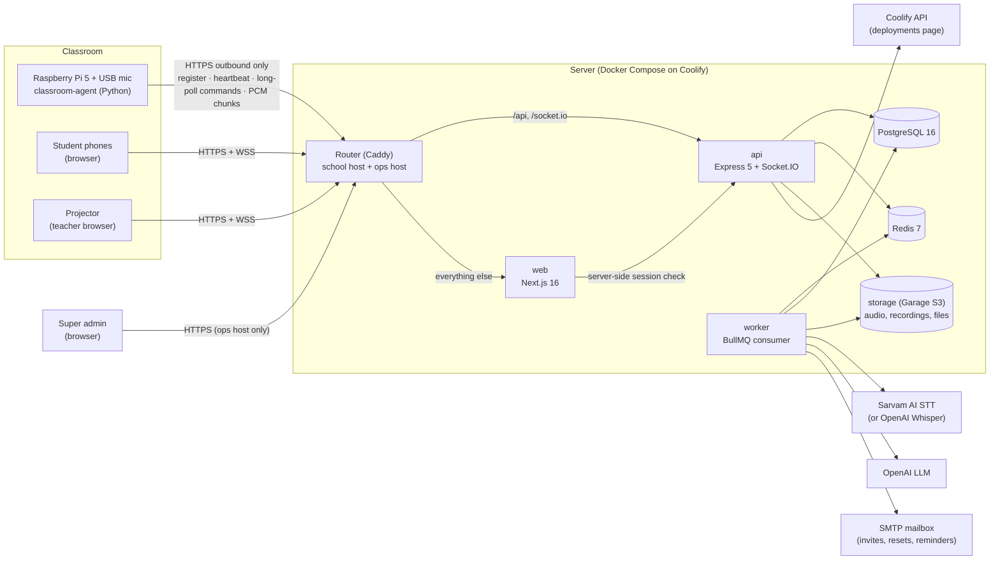

# ClassPulse architecture

ClassPulse turns classroom lectures into reviewed, bilingual quizzes and live classroom games, and gives teachers secure exams, assignments and AI teaching tools. Many schools share one installation; a separate super admin console (its own host, login and session) runs them all.

Two public hosts reach the same router. The school host (e.g. `classpulse.benxsolutions.in`) serves `/admin`, `/teacher`, `/student`, `/api` and `/socket.io`, and returns 404 for `/platform`. The ops host (e.g. `ops.benxsolutions.in`) serves only `/platform`, `/api/platform/*` and `/api/status` (`infra/Caddyfile*`, `PLATFORM_HOST`).

## Components

| Component | Code | Responsibility |
|---|---|---|
| Web app | `apps/web` | One Next.js app, installable as a PWA. `/admin` is the school console; `/teacher` is the studio (recording and review, live quizzes, assignments, exams, AI teaching tools, courses and materials, simulations, class insights); `/student` is the mobile-first portal (quizzes, live quiz, assignments, exams, with a first-login guided tour). Each role has its own sign-in page (`/admin/login`, `/teacher/login`, `/student/login`, rewritten by `proxy.ts`); `/platform` is the super admin console with its own sign-in and `cp_platform` session. Area layouts check the role on the server, and `proxy.ts` sends anonymous visitors to the right sign-in page. |
| API | `apps/api` | Handles REST and Socket.IO, authentication and RBAC, per-school feature switches, suspension and maintenance checks, validation, the device contract, the live-quiz and exam engines, the platform console API (`/api/platform/*`), the audit log and the database log sink. It is the only security boundary. |
| Worker | `apps/api/src/worker.ts` | Consumes three BullMQ queues: `lesson-generation` (ffmpeg, then Sarvam STT, then the OpenAI quiz; 3 attempts with backoff), `email` (invites, resets and reminders over SMTP) and `resources` (lesson plans, worksheets, question papers, presentations). It writes a heartbeat for the health page and runs the maintenance tasks: audio retention, device-offline sweep, exam auto-submit sweep, assignment reminders, log and audit retention, and health snapshots. Without Redis (development) the API process runs all of this in-process. |
| Shared contracts | `packages/shared` | zod schemas and TypeScript types used by both the API and the web app, so the two cannot drift apart. |
| Object storage | `apps/api/src/lib/storage.ts`, `infra/garage/` | One interface for stored files (lecture audio, Pi recording chunks, submissions, materials) with two drivers chosen by `STORAGE_DRIVER`: `local` (a folder on the `storage_data` volume) and `s3` (a bucket on Garage, a single-node S3-compatible store in the same compose stack, internal only). Keys are opaque and identical in both. Temporary files (uploads in progress, transcodes, S3 downloads) always stay on local disk in `TMP_DIR`. Files are never served by the store directly: the API streams them, range requests included. |
| Classroom agent | `apps/classroom-agent` | Python standard-library service on the Raspberry Pi. It records with `arecord`, buffers to disk, and uploads resumable chunks. |

## Key flows

### Recording a lecture

1. The teacher picks a section and presses **Start recording** (`POST /api/recordings`). The API creates a lesson with status `recording`, a `recording_session`, and a `start_recording` device command.
2. The Pi in the section's room picks up the command through its long-poll (`GET /api/devices/me/commands`) and acknowledges it. It then records 16 kHz mono PCM in 60-second chunks to its local disk.
3. The uploader on the Pi sends each chunk with `PUT …/chunks/:idx` and an `X-Chunk-SHA256` header. If the Wi-Fi drops, chunks wait on disk and the upload resumes from the server's `received` list.
4. The teacher presses **Stop**. The Pi drains its backlog and calls `finalize`. The API checks that every chunk is present, assembles a WAV file, attaches it to the lesson and queues **transcription**.
5. The worker transcribes with the institution's chosen speech-to-text provider (Sarvam or OpenAI Whisper, set in **Admin → AI settings**; both return real timestamps). The lesson becomes `transcribed` ("Ready for quiz").
6. The teacher chooses the **number of questions** (1–30) and the **difficulty** (easy / medium / hard / mixed) and presses **Generate quiz** (`POST /api/lessons/:id/generate`). The worker writes the questions (plus summary and assignment for a fresh quiz) with OpenAI, validates each question with zod, tops up missing ones, and sets the lesson to `ready_for_review`. If generation fails, the lesson becomes `failed` with a plain-language reason; the system never substitutes demo content.
7. The teacher reviews, edits and approves the questions — and can add more, replace the unapproved ones or start over — then publishes. Students in the section can then see the quiz.

A teacher can also upload an audio file instead (`POST /api/lessons/:id/audio`); it is transcribed automatically and follows the same steps. The complete owner's handbook is `docs/agents/HANDBOOK.md`.

### Teacher AI tools

A teacher picks a type (lesson plan, worksheet, question paper or presentation) and, optionally, a course, units, recorded lessons and uploaded materials, then describes the request (typed, or spoken as a voice prompt). `POST /api/resources/generate` stores a `teaching_resources` row and queues a `resources` job. The job builds grounding text (unit summaries, the teacher's lesson transcripts, material text), calls the type's generator (strict JSON schema, zod validation, one repair round, deterministic fixes) and saves the content. The teacher can edit it, export it (Word or PowerPoint, or print to PDF) and share it with the school. A question paper's MCQs can be published as a draft secure exam.

### Exams and assignments

- **Exams:** a teacher builds a timed exam from approved questions (or a question paper). Each student gets their own shuffled set, answers autosave, and leaving fullscreen or the tab is recorded as an integrity event. A sweep auto-submits attempts when time runs out.
- **Assignments:** standalone or per lesson, with optional file uploads, rubrics, a late policy and email reminders. Teachers grade with an optional AI suggestion and return marks and feedback.

### Super admin console

The owner signs in on the ops host with a password plus an authenticator code (TOTP; the secrets are encrypted with `PLATFORM_ENCRYPTION_KEY`). The console creates schools and their admins, switches features and limits per school, suspends schools, sets maintenance mode and banners, and shows health, live logs, the audit log, usage and estimated AI cost, and Coolify deployments.

### Live quiz

- The teacher creates a live session and gets a 6-digit PIN. Students join from their phones over Socket.IO, and the session cookie identifies each student.
- The server owns the clock. Each question closes automatically at its deadline. Students can change their answer until then, but they never see the answer key before the question closes.
- Every state transition and answer is written to Postgres, so an API restart can rebuild the room.
- The projector view (`/teacher/lessons/:id/present`) joins as a second, read-only host screen.

## Security model

- **Sessions.**
  - Login sets an httpOnly, SameSite=Lax session cookie, which is Secure in production. The JWT inside it holds `sub`, `ver` and `role`.
  - Every request reloads the user from the database, so disabled accounts and changed passwords (`token_version`) take effect immediately.
- **Passwords.**
  - Passwords are hashed with bcrypt (cost 12).
  - Passwords issued by an admin must be changed on first login.
  - Login is rate-limited per IP and per identifier.
- **Separate identities.**
  - Each role signs in on its own page and endpoint (`/api/auth/{admin|teacher|student}/login`), which refuses other roles.
  - Super admins live in their own table and session (`cp_platform`: SameSite=Strict, 2 hours, TOTP required, recovery codes). School sessions never reach `/api/platform/*`, and the console is served only on the ops host.
  - Platform sign-in is strictly rate-limited, and every platform action is written to the audit log.
- **School controls.** A suspended school's users are refused at sign-in and on every request; maintenance mode can block all school sign-ins; switched-off features return `FEATURE_DISABLED` (`requireFeature`).
- **Authorization.**
  - Every router applies `authenticate()` and `requireRole()`.
  - Services enforce ownership: teachers can only access their own lessons and the sections they teach, and students only the sections they are enrolled in.
  - Every query is scoped to the user's institution.
- **Input and storage.**
  - All inputs are validated with zod, which also strips unknown keys.
  - Files are addressed only by opaque storage keys; request data never becomes a filesystem path or object key.
  - The object store (Garage) publishes no ports and gives no presigned URLs. Other containers can reach only its S3 API; its admin API and RPC listen on the container's loopback, used only by `storage-init`, which shares its network namespace. Garage's own secrets go only to those two services. The application key can read and write one bucket and nothing else, and cannot create buckets.
  - Audio is served only through authenticated, range-capable endpoints. Nothing is served statically.
- **Devices.**
  - A device can register only with an admin-issued enrollment token, which is single-use and expires after 24 hours.
  - The server stores only the sha256 hash of the device key and compares keys in constant time.
  - Devices never accept inbound connections.
- **Privacy.**
  - Raw audio is deleted `AUDIO_RETENTION_DAYS` days after upload (30 by default).
  - Logs redact credentials and do not contain student names. Emailed set-password links are single-use, stored only as hashes, and expire after 72 hours.
  - Super admins can view a school's data read-only but cannot sign in as its users.

## Scaling notes

The pilot runs as a single instance of each service.

- **More API replicas:** add `@socket.io/redis-adapter` and move the live-room timers to a Redis-backed scheduler.
- **More worker throughput:** scale the `worker` service. BullMQ concurrency is set by `GENERATION_CONCURRENCY` (lessons); the `resources` queue runs 2 jobs at a time.
- **Zero-downtime deploys:** today every Coolify deploy recreates all containers (about 30–60 s of 503). Rolling updates need health-checked replicas behind the router.
- **Object storage:** stored files go to Garage (`STORAGE_DRIVER=s3`), so API and worker replicas, or a second server, share them over S3 instead of a host volume. One Garage node keeps one copy on the same disk, and the nightly backup is the only second copy. For redundancy, add a Garage node on another site with `replication_factor = 2` (see deployment.md → "Adding a second Garage node"). The driver speaks plain S3 (path-style), so moving to a managed store such as R2 or OCI Object Storage means changing the endpoint, region and key, not the code.
