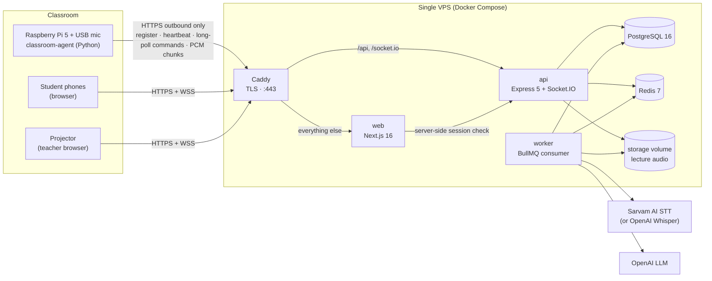

# ClassPulse architecture

ClassPulse turns classroom lectures into reviewed, bilingual quizzes and live classroom games.

## Components

| Component | Code | Responsibility |
|---|---|---|
| Web app | `apps/web` | One Next.js app. `/admin` is the institution console, `/teacher` is the recording, review and live-host studio, and `/student` is the mobile-first quiz portal. Each area's layout checks the user's role on the server, and `proxy.ts` redirects anonymous visitors to `/login`. |
| API | `apps/api` | Handles REST and Socket.IO, authentication and RBAC, validation, the device contract, and the live-quiz engine. It is the only security boundary. |
| Worker | `apps/api/src/worker.ts` | Runs the lesson-generation jobs (ffmpeg, then Sarvam STT, then the OpenAI quiz) from BullMQ with 3 attempts and exponential backoff. It also runs the maintenance tasks: audio retention and the device-offline sweep. |
| Shared contracts | `packages/shared` | zod schemas and TypeScript types used by both the API and the web app, so the two cannot drift apart. |
| Classroom agent | `apps/classroom-agent` | Python standard-library service on the Raspberry Pi. It records with `arecord`, buffers to disk, and uploads resumable chunks. |

## Key flows

### Recording a lecture

1. The teacher picks a section and presses **Start recording** (`POST /api/recordings`). The API creates a lesson with status `recording`, a `recording_session`, and a `start_recording` device command.
2. The Pi in the section's room picks up the command through its long-poll (`GET /api/devices/me/commands`) and acknowledges it. It then records 16 kHz mono PCM in 60-second chunks to its local disk.
3. The uploader on the Pi sends each chunk with `PUT …/chunks/:idx` and an `X-Chunk-SHA256` header. If the Wi-Fi drops, chunks wait on disk and the upload resumes from the server's `received` list.
4. The teacher presses **Stop**. The Pi drains its backlog and calls `finalize`. The API checks that every chunk is present, assembles a WAV file with ffmpeg, attaches it to the lesson and queues generation.
5. The worker transcribes with the institution's chosen speech-to-text provider (Sarvam or OpenAI Whisper, set in **Admin → AI settings**; both return real timestamps), generates the summary, questions and assignment with OpenAI (validated with zod), and sets the lesson to `ready_for_review`. If generation fails, the lesson becomes `failed` with a plain-language reason; the system never substitutes demo content.
6. The teacher reviews, edits and approves the questions, then publishes. Students in the section can then see the quiz.

A teacher can also upload an audio file instead (`POST /api/lessons/:id/audio`). The pipeline is the same.

### Live quiz

- The teacher creates a live session and gets a 6-digit PIN. Students join from their phones over Socket.IO, and the session cookie identifies each student.
- The server owns the clock. Each question closes automatically at its deadline. Students can change their answer until then, but they never see the answer key before the question closes.
- Every state transition and answer is written to Postgres, so an API restart can rebuild the room.
- The projector view (`/teacher/lessons/:id/present`) joins as a second, read-only host screen.

## Security model

- **Sessions.**
  - Login sets an httpOnly, SameSite=Lax session cookie, which is Secure in production. The JWT inside it holds `sub`, `ver` and `role`.
  - Every request reloads the user from the database, so disabled accounts and changed passwords (`token_version`) take effect immediately.
- **Passwords.**
  - Passwords are hashed with bcrypt (cost 12).
  - Passwords issued by an admin must be changed on first login.
  - Login is rate-limited per IP and per identifier.
- **Authorization.**
  - Every router applies `authenticate()` and `requireRole()`.
  - Services enforce ownership: teachers can only access their own lessons and the sections they teach, and students only the sections they are enrolled in.
  - Every query is scoped to the user's institution.
- **Input and storage.**
  - All inputs are validated with zod, which also strips unknown keys.
  - Files are addressed only by opaque storage keys; request data never becomes a filesystem path.
  - Audio is served only through authenticated, range-capable endpoints. Nothing is served statically.
- **Devices.**
  - A device can register only with an admin-issued enrollment token, which is single-use and expires after 24 hours.
  - The server stores only the sha256 hash of the device key and compares keys in constant time.
  - Devices never accept inbound connections.
- **Privacy.**
  - Raw audio is deleted `AUDIO_RETENTION_DAYS` days after upload (30 by default).
  - Logs redact credentials and do not contain student names.

## Scaling notes

The pilot runs as a single instance of each service.

- **More API replicas:** add `@socket.io/redis-adapter` and move the live-room timers to a Redis-backed scheduler.
- **More worker throughput:** scale the `worker` service. BullMQ concurrency is set by `GENERATION_CONCURRENCY`.
- **Object storage:** implement the S3/R2 driver behind `lib/storage.ts`.
