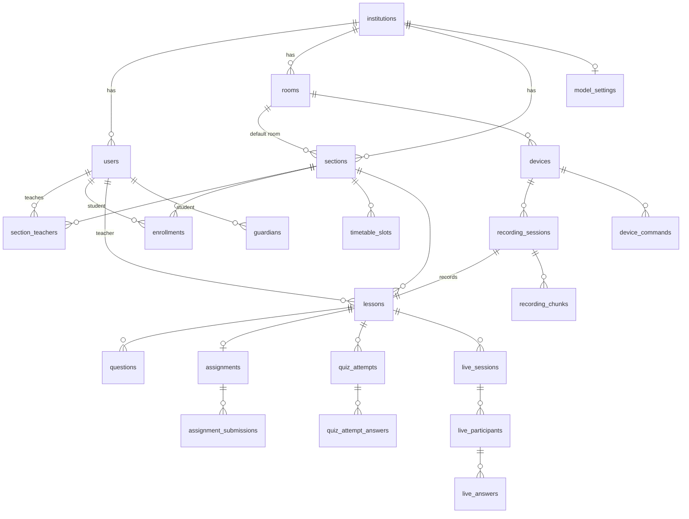

# Database (PostgreSQL 16 + Drizzle ORM)

- **Schema source:** `apps/api/src/db/schema/*.ts`.
- **Migrations:** `apps/api/src/db/migrations/`. Generate them with `npm run db:generate` and apply them with `npm run db:migrate`.
- **Keys and timestamps:** every primary key is a UUID, and every timestamp is `timestamptz`.
- **Scoping:** every tenant-scoped row is linked to an institution through `institution_id`, either directly or through its parent.

## Tables

| Table | Purpose | Notable constraints |
|---|---|---|
| `institutions` | Schools | `code` unique |
| `users` | Admins, teachers and students in one table (`role`). Holds `password_hash`, `must_change_password`, `token_version` (session revocation) and `status`. | `email` unique where set. `(institution_id, roll_number)` unique where set. |
| `rooms` | Physical classrooms. A room may host a device. | `(institution_id, name)` unique |
| `sections` | Class cohorts with a 6-character `join_code` and its expiry | `join_code` unique |
| `section_teachers` / `enrollments` | M:N links: teachers↔sections and students↔sections | composite PKs |
| `timetable_slots` | Weekly schedule | `(section_id, day, period)` unique |
| `lessons` | Lecture and generation state: status enum, audio storage key and its expiry, `transcript` and `transcript_segments` (JSONB), summary and takeaways, progress, `failure_reason`, `pipeline_meta` (JSONB), cached `remedial` plan (JSONB) | indexes on teacher, (section, status), audio expiry |
| `questions` | 4-option MCQs, with local-language fields (`options_local` JSONB) and citation seconds | `correct_index` CHECK 0–3 |
| `assignments` / `assignment_submissions` | One assignment per lesson. Each student submits once and may edit until due. | `lesson_id` unique, `(assignment_id, student_id)` unique |
| `quiz_attempts` / `quiz_attempt_answers` | Self-paced attempts. Each answer **snapshots** the stem, options and correct index so the result stays valid if the lesson is regenerated. | `(student_id, idempotency_key)` unique |
| `live_sessions` / `live_participants` / `live_answers` | Durable live-quiz state: PIN, status, question timing, scores, answer revisions | PIN unique among non-ended sessions. `(session, student)` and `(participant, question)` unique. |
| `guardians` | Student guardian contacts | `(student_id, phone)` unique |
| `model_settings` | AI provider and model choice for each institution | PK = institution |
| `devices` | Raspberry Pi recorders. Stores **only** `api_key_hash`. | `device_id` unique |
| `device_enrollment_tokens` | Single-use 24-hour provisioning tokens (hashed) | `token_hash` unique |
| `device_commands` | Outbound command queue (`start_recording` / `stop_recording`) with expiry | |
| `recording_sessions` / `recording_chunks` | Device recording lifecycle and received chunk index (sha256, size, storage key) | one active session per device (partial unique index). `(session_id, idx)` unique. |

## Conventions

- Deletes cascade from a parent to its children. A `restrict` constraint prevents deleting anything that would orphan teaching history: a teacher who owns lessons, a section that has lessons, or a room that has devices.
- JSONB is used only for data that is opaque or produced by the AI: transcript segments, rubric, options, pipeline metadata, device stats and the remedial plan. Everything relational lives in typed columns.
- Use `db.transaction` for any change that spans several tables.
