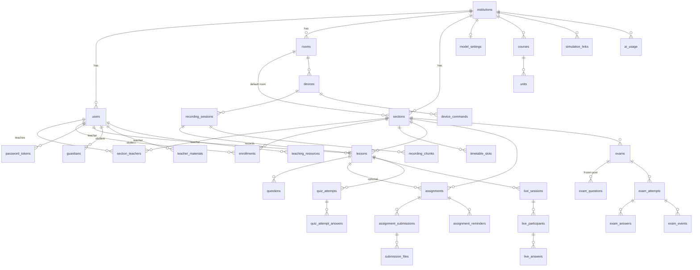

# Database (PostgreSQL 16 + Drizzle ORM)

- **Schema source:** `apps/api/src/db/schema/*.ts` (`org`, `content`, `live`, `devices`, `exams`, `teacherTools`, `platform`, `enums`).
- **Migrations:** `apps/api/src/db/migrations/`. Generate them with `npm run db:generate` and apply them with `npm run db:migrate`. In production the API applies them on every start.
  - `0000_init`: the first 23 tables.
  - `0001_teacher_quiz_generation`: the `transcribed` lesson status and `lessons.quiz_request`.
  - `0002_invites_exams_assignments`: 8 tables (set-password links, assignment files and reminders, secure exams), and standalone or multiple assignments per lesson.
  - `0003_platform`: 7 tables for the super admin console, plus each institution's status, feature switches, limits, contact and notes.
  - `0004_teacher_tools`: 5 tables for courses, units, materials, teaching resources and simulation links, plus the Bloom level and competency tags on questions.
- **Size:** 43 tables.
- **Keys and timestamps:** primary keys are UUIDs, except the append-only platform logs (`audit_logs`, `app_logs`, `ai_usage`, `email_log`, `health_snapshots`), which use a `bigserial`, and `platform_settings`, which is keyed by name. Every timestamp is `timestamptz`.
- **Scoping:** every tenant-scoped row is linked to an institution through `institution_id`, either directly or through its parent. The platform tables sit above all institutions.

## Tables

### School and people (`org.ts`)

| Table | Purpose | Notable constraints |
|---|---|---|
| `institutions` | Schools. Also holds the console's controls: `status` (active/suspended, with reason and time), `features` and `limits` (JSONB), `contact` and private `notes`. | `code` unique |
| `users` | Admins, teachers and students in one table (`role`). Holds `password_hash`, `must_change_password`, `token_version` (session revocation) and `status`. | `email` unique where set. `(institution_id, roll_number)` unique where set. Deleting an institution with users is restricted. |
| `rooms` | Physical classrooms. A room may host a device. | `(institution_id, name)` unique |
| `sections` | Class cohorts with a 6-character `join_code` and its expiry | `join_code` unique. `(institution_id, name)` unique. |
| `section_teachers` / `enrollments` | M:N links: teachers↔sections and students↔sections | composite PKs |
| `timetable_slots` | Weekly schedule | `(section_id, day, period)` unique |
| `password_tokens` | Emailed set-password links (`invite` or `reset`). Stores only the SHA-256 of each token, with expiry, use, revocation and email delivery status. | `token_hash` unique |

### Lessons, quizzes and homework (`content.ts`)

| Table | Purpose | Notable constraints |
|---|---|---|
| `lessons` | Lecture and generation state: status enum, audio storage key and its expiry, `transcript` and `transcript_segments` (JSONB), summary and takeaways, progress, `failure_reason`, `pipeline_meta` (JSONB), `quiz_request` (JSONB), cached `remedial` plan (JSONB) | indexes on teacher, (section, status), audio expiry |
| `questions` | 4-option MCQs, with local-language fields (`options_local` JSONB), citation seconds, and the Bloom level and competency tags | `correct_index` CHECK 0–3 |
| `assignments` | Homework, either standalone (`lesson_id` null) or attached to a lesson (several per lesson). Belongs to a section. `is_primary` marks the lesson's AI-drafted assignment. Rubric, due date, late policy, file settings, reminders, status. | at most one primary assignment per lesson (partial unique index) |
| `assignment_submissions` | One submission per student per assignment: text, late flag, rubric marks, feedback, grading and return dates, stored AI suggestion | `(assignment_id, student_id)` unique |
| `submission_files` | Files attached to a submission (name, MIME type, size, storage key) | |
| `assignment_reminders` | Which due-date reminder emails were sent, so none goes twice | PK `(assignment_id, student_id)` |
| `quiz_attempts` / `quiz_attempt_answers` | Self-paced attempts. Each answer **snapshots** the stem, options and correct index so the result stays valid if the lesson is regenerated. | `(student_id, idempotency_key)` unique |
| `guardians` | Student guardian contacts | `(student_id, phone)` unique |
| `model_settings` | AI provider and model choice for each institution | PK = institution |

### Live quiz (`live.ts`)

| Table | Purpose | Notable constraints |
|---|---|---|
| `live_sessions` / `live_participants` / `live_answers` | Durable live-quiz state: PIN, status, question timing, scores, answer revisions | PIN unique among non-ended sessions. `(session, student)` and `(participant, question)` unique. |

### Classroom devices (`devices.ts`)

| Table | Purpose | Notable constraints |
|---|---|---|
| `devices` | Raspberry Pi recorders. Stores **only** `api_key_hash`. | `device_id` unique |
| `device_enrollment_tokens` | Single-use 24-hour provisioning tokens (hashed) | `token_hash` unique |
| `device_commands` | Outbound command queue (`start_recording` / `stop_recording`) with expiry | |
| `recording_sessions` / `recording_chunks` | Device recording lifecycle and received chunk index (sha256, size, storage key) | one active session per device (partial unique index). `(session_id, idx)` unique. |

### Secure exams (`exams.ts`)

| Table | Purpose | Notable constraints |
|---|---|---|
| `exams` | A timed exam for a section: window (`opens_at`, `closes_at`), duration, questions per student, shuffle, fullscreen, access code, single-device and auto-submit settings, results visibility, status | deleting the teacher or section is restricted |
| `exam_questions` | The pool, **frozen** at publish as a snapshot of lesson questions (stem, options, correct index, translations) | |
| `exam_attempts` | One attempt per student: their paper (questions and option order), deadline, extra minutes, SHA-256 of the device token, warning count, score | `(exam_id, student_id)` unique |
| `exam_answers` | Each saved answer (canonical option index, revision) | `(attempt_id, exam_question_id)` unique |
| `exam_events` | Integrity timeline: leaving fullscreen, tab switches, copy/paste, second device… | |

### Teacher tools (`teacherTools.ts`)

| Table | Purpose | Notable constraints |
|---|---|---|
| `courses` / `units` | Syllabus courses (from the catalog or hand-made, optionally linked to a section) and their ordered units with summary and objectives | |
| `teacher_materials` | Uploaded PDF, DOCX or text files and their extracted text, optionally linked to a course or unit | |
| `teaching_resources` | Generated lesson plans, worksheets, question papers and presentations: request, grounding ids, options, content (JSONB), status, `shared` flag | partial index on shared resources |
| `simulation_links` | Simulation links a school's teachers added | |

### Platform console (`platform.ts`)

| Table | Purpose | Notable constraints |
|---|---|---|
| `platform_admins` | Super admins (not rows in `users`): password hash, `must_change_password`, `token_version`, AES-256-GCM encrypted TOTP secret, last accepted TOTP step, bcrypt hashes of recovery codes | `email` unique |
| `platform_settings` | Key → JSON value: maintenance, banner, default AI models, AI price rates | PK = `key` |
| `audit_logs` | Who did what, school users and super admins alike (kept 365 days) | `institution_id` set null on delete |
| `app_logs` | A filtered copy of application log lines for the console (kept 14 days) | |
| `health_snapshots` | A health check every 5 minutes for the history chart (kept 30 days) | |
| `ai_usage` | One row per AI provider call: purpose, provider, model, tokens or audio seconds, success | `institution_id` set null on delete |
| `email_log` | Every email the queue tried to deliver; the recipient is stored only as a SHA-256 | |

## Conventions

- Deletes cascade from a parent to its children. A `restrict` constraint prevents deleting anything that would orphan teaching history: a teacher who owns lessons, assignments or exams, a section that has lessons or exams, or a room that has devices.
- JSONB is used only for data that is opaque or produced by the AI: transcript segments, rubric, options, pipeline metadata, device stats, the remedial plan, exam papers, resource content, feature switches and limits, and platform settings. Everything relational lives in typed columns.
- Use `db.transaction` for any change that spans several tables.
