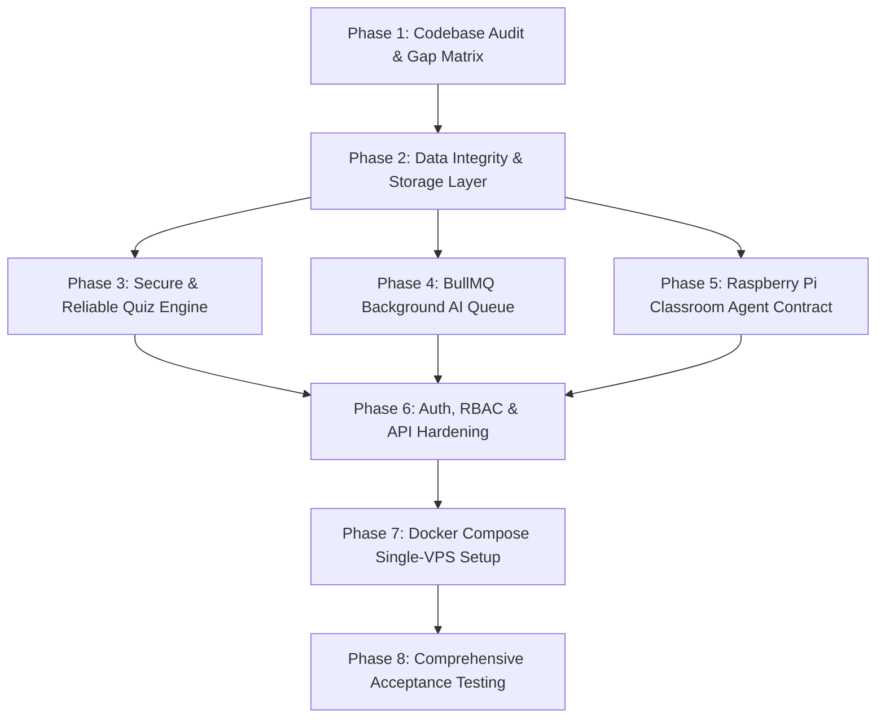

# ClassPulse — Production Readiness Plan

> **Objective:** Make ClassPulse reliable, secure, maintainable, and deployable for an initial production pilot of ~100 users, with a Raspberry Pi 5 in each classroom for audio capture and mobile web quizzes for students.

---

## Dependency Graph & Phase Sequencing

---

## Phase Breakdown & Verification Tasks

### Phase 2: Data Persistence and Correctness
- [ ] Task 2.1: Create persistent Mongoose models for `StudentSubmission`, `Timetable`, `Guardian`, and `QuizSession`.
- [ ] Task 2.2: Refactor `studentQuizRoutes.ts` to query/write `StudentSubmission` in DB with idempotency keys and atomic updates (remove `quizSubmissions = new Map()`).
- [ ] Task 2.3: Refactor `adminRoutes.ts` and `studentRoutes.ts` to persist timetables, guardians, and model settings to DB (remove in-memory variables).
- [ ] Task 2.4: Create storage adapter interface (`StorageService`) supporting local volume mounts and S3/R2 object storage with signed URLs.
- [ ] **Verification**: Restart backend process; verify that submitted student quizzes, timetables, and guardians remain intact.

### Phase 3: Secure and Reliable Quiz Engine
- [ ] Task 3.1: Enforce server-side deadlines in `quizSocket.ts` based on `room.questionStartedAt + q.timeLimitSec`.
- [ ] Task 3.2: Allow students to change/update their answer before question deadline, storing an auditable history of revisions.
- [ ] Task 3.3: Never leak `correctIndex` or explanations to individual students while the question timer is running; reveal only upon question close or host reveal.
- [ ] Task 3.4: Implement student session recovery tokens so mobile devices dropping Wi-Fi can reconnect without losing score or active question state.
- [ ] Task 3.5: Scope all live quiz events strictly to the classroom's active PIN.
- [ ] **Verification**: Run simulated multi-client test with concurrent submissions, answer revisions, and simulated socket disconnections.

### Phase 4: Background AI Processing
- [ ] Task 4.1: Install and configure `bullmq` and `ioredis` in `SIH-backend`.
- [ ] Task 4.2: Migrate `lessonGeneration.ts` from floating promises to a BullMQ queue (`audio-transcription-queue`) with bounded concurrency (2 jobs max on VPS) and 3 retries with exponential backoff.
- [ ] Task 4.3: Track job states (`queued`, `processing`, `completed`, `failed`) and persist progress to `Lesson.generationProgress`.
- [ ] Task 4.4: Ensure teacher review and approval (`status: 'ready_for_review'`) remains mandatory before publishing.
- [ ] **Verification**: Submit audio generation job; restart backend midway; verify worker resumes or cleanly reports failure without leaving orphaned lessons.

### Phase 5: Raspberry Pi Classroom Agent
- [ ] Task 5.1: Define backend API contract for device registration (`POST /api/device/register`), heartbeats (`POST /api/device/heartbeat`), and chunked audio upload (`POST /api/device/upload`).
- [ ] Task 5.2: Create standalone `classroom-agent/` service with Python/Node script:
  - Local circular audio buffer.
  - Resumable upload with exponential backoff.
  - Heartbeat reporter (CPU temp, disk space, mic status).
  - Outbound TLS API client.
- [ ] Task 5.3: Provide `systemd/classpulse-agent.service` for automatic boot and restart on Raspberry Pi 5.
- [ ] **Verification**: Run agent against backend; verify heartbeat updates in Admin console and audio buffer uploads cleanly.

### Phase 6: Authentication and Authorization
- [ ] Task 6.1: Implement unified `authenticateToken` middleware and role checkers (`requireRole(['admin' | 'teacher' | 'student'])`).
- [ ] Task 6.2: Mount auth guards across all `/api/lessons`, `/api/questions`, `/api/admin`, and `/api/student` routes.
- [ ] Task 6.3: Remove hardcoded student login bypass (`password !== 'student123'`) and auto-enrollment in arbitrary sections.
- [ ] Task 6.4: Add `helmet`, `express-rate-limit` on auth and AI endpoints, and sanitize logs.
- [ ] **Verification**: Send unauthenticated or cross-role requests; verify 401 Unauthorized and 403 Forbidden responses.

### Phase 7: Deployment and Observability
- [ ] Task 7.1: Create production `docker-compose.prod.yml` with private internal network for MongoDB and Redis.
- [ ] Task 7.2: Add Caddy or Nginx reverse proxy with TLS and WebSocket upgrade proxying.
- [ ] Task 7.3: Add deep health check endpoint (`GET /api/health`) verifying DB, Redis, and storage connectivity.
- [ ] Task 7.4: Add structured logger (`pino`) with log levels and request IDs.
- [ ] **Verification**: Run `docker compose -f docker-compose.prod.yml up` and test health endpoint.

### Phase 8: Acceptance Testing
- [ ] Task 8.1: Write integration tests for auth, deadlines, answer revisions, and concurrent submissions.
- [ ] Task 8.2: Run test suite against running system and report actual metrics.

